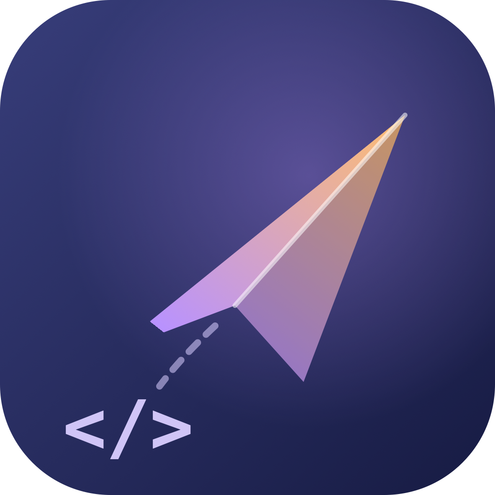

# postme



A **lightweight native macOS API client** — an alternative to ApiPost / Postman.

It has exactly one goal: give back the memory those tools keep resident.


---

## Why this exists

ApiPost stays open all day and uses a lot of memory. Tauri was tried, but like Electron it
embeds WKWebView on macOS — the WebKit content process alone costs tens to over a hundred MB,
so nothing is saved.

So this app uses **no WebView at all**: SwiftUI draws the interface, `URLSession` sends requests.
The cost is macOS-only; the payoff is an order-of-magnitude difference in memory.

### Measured memory

| | postme | ApiPost |
|---|---|---|
| Physical footprint (phys_footprint) | **~40 MB** | 288 MB (peak 424 MB) |
| Processes | 1 | 5 (RSS total 261 MB+) |
| Install size | 2.1 MB | — |

> Measurement note: these are **phys_footprint** values as shown in Activity Monitor, not `ps` RSS.
> postme's RSS is about 116 MB, but most of that is pages shared with system frameworks — RSS counts
> shared libraries once per process, which badly distorts comparisons between similar apps.
> phys_footprint is the honest number.

---

## Features

### Request debugging
- Methods: GET / POST / PUT / PATCH / DELETE / HEAD / OPTIONS
- Headers and query parameters (each row can be enabled/disabled)
- Request bodies: JSON, raw text, form URL-encoded, multipart form (text fields), none
- Responses: status code, headers, body (JSON auto-pretty-printed, read-only syntax highlighting)
- **JSON syntax highlighting while editing** — keys, strings, numbers and literals in distinct
  colors; highlighting is debounced so typing stays responsive
- **Cancellable** — interrupt an in-flight request at any time (button or `⌘.`); cancelling is not a
  failure and is not recorded in history
- **Bounded response memory** (16 MB): huge responses cannot exhaust memory; truncation is stated
  explicitly
- **Phase timings**: DNS / TCP connect / TLS handshake / time to first byte (TTFB) / download
- Request history (recorded automatically, restorable to the editor)
- **Draft protection**: switching requests with unsaved edits asks first (save and continue /
  discard / cancel); the draft itself is debounced to disk so a crash does not lose it

### Project management (ApiPost-style project layer)
- **Project switcher** at the top of the sidebar: one project in focus, the tree shows only it
- Create / rename / delete projects (deleting removes all folders and requests and cannot be undone;
  at least one project is kept)
- Nested folders inside a project; rename and delete; promote a top-level folder to a project
- **Save**: if the draft belongs to a saved request, `⌘ S` overwrites it in place (the ownership is
  persisted with the draft, so after a restart it still overwrites instead of creating a duplicate);
  otherwise a sheet asks for a name — the target project defaults to the current one, and both
  project and folder can be changed
- Search by name/URL within the current project
- **Postman Collection v2.1 import/export** (ApiPost, Postman and Insomnia all export this format)
- Each imported collection becomes a **project with the same name** and is activated; export covers
  the **current project**
- Authentication is preserved on import: bearer / basic / apikey are materialized as equivalent
  headers or query parameters; auth types that cannot be reconstructed statically (oauth2 and
  friends) are listed in the import result instead of being silently dropped
- **cURL import** (`⌘ ⇧ V`): paste a browser/Postman "Copy as cURL" command or a terminal command;
  import into a new project or the current one. Multiple commands and `--next` segments each become
  their own request
- Legacy `workspace.json` migrates automatically: old top-level collections are wrapped in a single
  "默认项目" project with node IDs preserved

### Environment variables
- Multiple environments; `{{name}}` substitution applies to URL, headers, parameters and body
- Built-in dynamic variables (no definition needed):

  | Variable | Value |
  |---|---|
  | `{{$timestamp}}` | current Unix seconds |
  | `{{$isoTimestamp}}` | ISO 8601 timestamp |
  | `{{$uuid}}` | UUID |
  | `{{$randomInt}}` | random integer |

> Undefined variables are **left as-is** and flagged in the UI; they are never silently replaced
> with an empty string.

### Language
- Switch between **System / 简体中文 / English** in Settings; the change applies immediately and is
  persisted
- All interface text, menus, dialogs, import warnings and error messages follow the selected
  language

### Explicitly out of scope
Accounts, cloud sync, pre-request scripts and assertions, team collaboration.

---

## Build and run

### Requirements
- macOS 14.0 or later
- Xcode or a Swift toolchain (developed and verified with Swift 6.3 / Xcode 26)

### Commands

```bash
make app     # build and bundle build/postme.app (ad-hoc signed)
make open    # bundle, then open via LaunchServices (menu bar and focus behave correctly)
make run     # run directly for development (debug; AppDelegate activates the app)
make build   # compile only
make clean   # remove build products
```

After the first build, drag `build/postme.app` into Applications for daily use.

> **Why not just `swift run`**: a bare binary launches as an accessory process — the window is not
> brought forward and there is no application menu. `NSApplicationDelegateAdaptor` provides an
> activation fallback, but the `.app` bundle is the normal way to run it.

### Zero dependencies

`Package.swift` declares no `dependencies`. Everything is built on Foundation / SwiftUI / AppKit.

---

## Usage notes

### Keyboard shortcuts

| Action | Shortcut |
|---|---|
| Send request | `⌘ ↩` |
| Cancel request | `⌘ .` |
| Save request | `⌘ S` |
| New request | `⌘ N` |
| Search requests | `⌘ F` |
| Import cURL | `⌘ ⇧ V` |
| Import as project | `⌘ ⇧ I` |
| Export project | `⌘ ⇧ E` |
| Settings | `⌘ ,` |

### Data storage

All state lives in a **single JSON file**:

```
~/Library/Application Support/postme/workspace.json
```

It contains projects (each with a folder tree), environments, history, settings, and the unsaved
draft (including which saved request it belongs to). Because it is a readable text file it can be
backed up or versioned with git. Writes are debounced by 600 ms and flushed synchronously on quit.

Legacy files with a top-level `collections` key are migrated on first load into a single
"默认项目" project, with node IDs preserved.

**Decoding is tolerant**: missing fields, wrong types and unknown enum values fall back to defaults
instead of invalidating the whole file. A genuinely corrupt file is backed up as
`workspace.json.corrupt-<timestamp>` (with a numeric suffix on collision) and the app starts with an
empty workspace — data is never silently dropped. If the backup itself fails, the original file is
left untouched and is never overwritten by an empty workspace.

### Debugging intranet services

`Info.plist` enables `NSAppTransportSecurity → NSAllowsArbitraryLoads`.
**This is required** — otherwise requests to `http://localhost` or `http://192.168.x.x` are blocked
by ATS, and the resulting error is hard to diagnose.

For HTTPS services with self-signed certificates, turn on the corresponding switch in
Settings → "Skip HTTPS certificate validation (self-signed)" (it affects TLS validation only and is off by
default).

---

## Design notes

A few non-obvious decisions that came out of real bugs:

**Encoding is done by hand, not by `URLComponents`.**
Foundation does **not** encode `+` when serializing query items. Under the form-urlencoded
convention used by PHP, Java servlets, Python `parse_qs`, Rails and many other servers, `+` in a
query or form value decodes to a **space** — so `+8613800138000` silently becomes " 8613800138000".
Silently altering user input is unacceptable in an API client, so `FormEncoding` encodes values
itself and excludes `+`, along with `& = ? # %`, from the allowed set.

**The "final URL" preview must equal the final URL.**
The preview and the send path used to have separate implementations, and they diverged twice:
first on encoding (the preview showed `+`, the server received `%2B`), then on variable
substitution (the preview encoded `{{baseUrl}}` as `%7B%7BbaseUrl%7D%7D` while the actual request
used the substituted address). The preview now runs the whole pipeline: **`AppState.resolveDraft`
substitutes variables, then `RequestExecutor.previewURL` merges and encodes the query** — the same
entry point as sending, so the two cannot structurally disagree.

**`URLSession` strongly retains its delegate.**
The delegate is the executor itself, forming an `executor → session → executor` cycle, so `deinit`
never runs. Rebuilding the executor after a settings change must call `invalidate()` explicitly;
otherwise every change leaks a session.

**Text controls must disable every "smart" substitution.**
macOS smart quotes turn a straight `"` in JSON into a curly `”`, silently corrupting the request
body in a way that is very hard to trace. `CodeTextView` disables smart quotes, dashes, text
replacement, spelling correction, continuous spell checking, grammar checking, link detection, and
smart insert/delete — eight switches in total.

**The bundling script must sign last.**
Signing before modifying `Info.plist` invalidates the signature, and the system SIGKILLs the app on
launch.

**Large responses must not block the main thread.**
Bodies over 2 MB are truncated for display, and syntax highlighting is skipped above 1 MB (the same
applies to request bodies). The text view decides whether to update from a cached written value
instead of reading `textView.string`, because that accessor materializes the entire text storage
into a new string on every call.

**"Low memory" cannot be a display-layer trick.**
The display threshold only bounds the text that is rendered, not memory — a measured 120 MB
response took the process from 2 MB to 147 MB, erasing exactly the advantage this project exists
for. So the transport layer has its own 16 MB hard cap: once exceeded it stops accumulating,
cancels the task, and surfaces the fact that the data itself is incomplete (`isBodyTruncated`).
Truncated JSON is no longer pretty-printed — that always fails, and falling back to the raw prefix
would suggest the response ended there.

**Truncation and user cancellation share the same underlying error code.**
Both surface as `NSURLErrorCancelled`, so they must be distinguished by explicit flags: truncation
returns a **partial response** with an honest marker, while user cancellation returns silently to
idle with no error and no history entry. Relying on `URLError` alone necessarily gets one of them
wrong.

**Workspace decoding must be tolerant, but tolerance has a floor.**
Compiler-synthesized decoding failed the entire `workspace.json` whenever any non-optional key was
missing; the file was then moved to `.corrupt-*` and the app started empty — collections,
environments and history gone at once, triggerable by **adding a single field**. Every persisted
model now decodes explicitly and tolerantly. But the floor remains: the file must be a JSON object
containing at least one recognizable workspace key (`version` alone does not count — `{"version":7}`
must not be claimed), otherwise it is still treated as corrupt and backed up. Silently treating an
unrelated file as an empty workspace and then overwriting it on the next save is worse than an
error.

**Rolling back UI state triggers callbacks and can override user intent.**
The draft-conflict prompt first rolls the sidebar selection back to the node being edited, but that
rollback fires `onChange` **again**, so the same logic runs a second time and replaces the node the
user actually clicked with the rolled-back one — after choosing "save and continue" the user stays
put. The fix is a state machine that refuses new actions while one is pending. State-machine unit
tests could never catch this: they call `openSavedRequest` directly and bypass the real `onChange`
entry point. Sidebar selection changes are now routed through `AppState.handleSidebarSelection`, so
the double-trigger path can be driven by tests.

**Postman import must not be all-or-nothing, and must not silently drop auth.**
`auth` is a first-class v2.1 field; ignoring it leaves every request in a Bearer-authenticated
collection returning 401 and the user concludes the tool is broken. Types that can be expressed
statically (bearer / basic / apikey) become equivalent headers or query parameters; types that need
dynamic signing (oauth2 and others) are listed in the import result instead of being pretended
away. Decoding is equally tolerant: `request` may be a string and `header` may be a raw string
block (both are allowed by the schema), and one malformed item should only affect itself, never
reject the whole file.

**cURL import targets byte-identical server behavior, not "looks similar".**
Commands are copied verbatim and users cannot see how postme understood them, so the only valid
criterion is what gets sent. That leads to several counter-intuitive choices: `-d` keeps curl's
implicit `Content-Type: application/x-www-form-urlencoded` even when the payload is bare JSON
(switching to `application/json` would change the server's parser); `--data-urlencode` values are
treated as **literal text** and are not percent-decoded first (curl encodes `%` along with
everything else, so decoding would remove one layer of escaping); under `-G`, both `-d` and
`--data-urlencode` go into the query. Global options that cannot travel with a request (`-k` /
`-L` / `-m` / `-x`) always appear in the warnings — silently ignoring them would make the import
look complete until the request is sent.

---

## Project layout

```
Sources/Postme/
├── PostmeApp.swift          @main + AppDelegate activation fallback + menu commands + Settings
├── AppState.swift           top-level state container (@MainActor @Observable) + draft-protection state machine
├── Models/                  plain data: requests, responses, projects, collection tree, environments, history, workspace
│   ├── Project              project layer (top-level container; migration target for legacy collections)
│   └── TolerantDecoding     tolerant-decoding helpers for persisted models
├── Services/                pure logic, Foundation only
│   ├── RequestExecutor      URLSession execution + task metrics + self-signed certs + response cap + cancellation
│   ├── FormEncoding         percent-encoding for query/form components
│   ├── VariableResolver     {{var}} substitution
│   ├── PostmanCodec         Postman v2.1 import/export (auth materialization, tolerant decoding)
│   ├── CurlCodec            cURL command parsing (quotes / line continuations / multiple commands / --next)
│   ├── Localization         language model and string tables
│   └── PersistenceService   workspace.json read/write + debounce + synchronous flush + corrupt-file backup
├── Views/                   SwiftUI interface
└── Components/              reusable controls (code text view, key-value editor, JSON highlighter)

Tests/PostmeTests/           test suite (including response-cap and cancellation cases over real sockets)
```

`Models/` and `Services/` deliberately do **not** import SwiftUI. The logic layer compiles without
the UI, which makes it suitable for both `swift test` regression runs and one-off CLI verification.

**Why tests live in the repository**: v1 kept its verification assertions in throwaway programs under
`/tmp`, outside version control — so any change had no regression net and a refactor could silently
undo a fixed behavior. They are now part of `Tests/PostmeTests/` and run with `swift test`.

---

## Known limitations

- **Multipart supports text fields only**, no file uploads.
- **History stores the unresolved template** (with `{{var}}` intact); this avoids writing plaintext
  secrets to disk, at the cost of showing templates rather than actual values in history.
- **JSON pretty-printing uses `JSONSerialization`, which does not preserve key order.**
- **`⌘F` is bound to sidebar search**, so the response body's find bar cannot be opened with a
  shortcut.
- **When a URL contains a hand-typed query and the parameter table also has entries, export/import
  prefers the parameter table.** The send path is unaffected (both are merged correctly).
- **The response body retention cap is 16 MB**: past that, reception stops and the response is
  marked truncated (saving bandwidth and time) rather than being fully read into memory. Smaller
  responses are unaffected.
- **Postman auth import is static materialization only**: bearer / basic / apikey become equivalent
  headers or query parameters; oauth1 / oauth2 / digest / awsv4 / hawk / ntlm / edgegrid require
  dynamic signing and cannot be reconstructed on import — they are listed in the import result
  rather than silently dropped.
- **Folders cannot be moved between projects**: v1 only offers a one-way "promote top-level folder
  to project".
- **Postman import always creates a new project** (it cannot merge into the current one); cURL
  import supports both.
- **cURL import covers only what can be reconstructed statically**: global options (`-k` / `-L` /
  `-m` / `-x` / client certificates), `-F key=@file` file fields and `@file` body reads cannot
  travel with a request and are reported in the import result rather than silently dropped. The
  same applies to the `name@file` / `@file` forms of `--data-urlencode`.
- **cURL import models the query as key-value pairs**: spaces encode as `%20` (curl uses `+`), and
  hex casing differs; after decoding `application/x-www-form-urlencoded` the result is equivalent to
  curl, but services that validate signatures over the **raw query string** may not agree. In
  addition, a literal `+` in the URL (`?q=a+b`) decodes to a space per form conventions, unlike
  strict RFC 3986 parsing — a structural consequence of modeling the query as key-value pairs.
- **Environments are global** and do not switch with projects (per-project environment isolation is
  not implemented).

## Verification status

- `swift test`: **all tests green** (`Tests/PostmeTests/`)
  - Covers variable substitution, Postman codec round-trips, collection trees, persistence, URL and
    request-body assembly, preview/send parity, workspace schema tolerance and legacy migration,
    project-layer state machine, response cap and cancellation, Postman auth and tolerant import,
    draft-protection state machine, cURL parsing and import persistence, and localization
    completeness
  - Response-cap and cancellation tests use a **real socket** (`LocalHTTPServer`), not mocks
  - `JSONHighlighterTests` covers the highlighting contract: distinct colors for keys / values /
    numbers / literals, escaped quotes do not terminate strings early, **highlighting changes not a
    single byte of the text**, highlighting works while editing, size-limit skipping, debounce and
    cancellation while editing, and JSON ↔ raw-text toggling (driven through a real SwiftUI host —
    see below)
- Editing-time highlighting cost was **measured** (throwaway program, not in the repo): highlighting
  is an O(n) attribute scan, about 10 ms for 200 KB; editing therefore uses a 150 ms debounce, while
  read-only response bodies are highlighted once.
  Measurements also confirmed that attribute writes do not enter the undo stack, do not fire
  `textDidChange`, and that typed characters do not inherit colors, so editing-time highlighting
  does not interfere with typing or `⌘Z`.
  One highlighting-toggle regression **only reproduces in a hosting view** (switching to raw text
  left stale colors), so that case is driven through `NSHostingView` rather than by calling the
  coordinator directly — the direct version passes even with the fix removed.
- The cURL parser was compared **byte-for-byte against real `curl`**: 18 representative commands
  (browser Copy as cURL, Windows/PowerShell continuations, `-G`, `-G -F`, multipart, `-u` / `-b` /
  `--oauth2-bearer`, ANSI-C quoting, `--next`, bare-JSON `-d`) were sent both by curl and by postme
  against a local echo server, comparing method / path / body / headers. All semantic items match;
  only three **intentional** representation differences remain (equivalent after server-side
  decoding): space encoding `%20` vs `+`, hex casing, and multipart boundary values.
  That comparison script is a throwaway program (not in the repo); the same assertions are pinned in
  the repository by `CurlCodecTests`.
- `swift build -c release`: zero warnings, zero errors
- Localization: `swift test` runs **223 tests**. `LocalizationTests` asserts that both string tables
  cover every key, that format placeholders match between languages (including `%.1f`), that the
  English table contains no CJK characters, that a language change is observable (the mechanism
  behind menu-bar recomputation), that the choice round-trips to disk, that cached response text is
  recomputed, and that the untitled-name placeholder is recognized in **both** languages — that last
  one is the failure mode where only the literal changes and the equality check does not, which
  compiles, passes a naive grep and still misnames history entries.
  A scan for user-visible Chinese string literals in `Views/`, `AppState` and `PostmeApp` returns
  zero hits; the remaining Chinese literals are tolerant-decoding defaults for persisted models, the
  legacy migration project name, and the language's own display name.
- Real app process: a legacy `workspace.json` with missing fields loads correctly with data intact
  and produces no `.corrupt-*`; unrelated JSON is still treated as corrupt and backed up
- Independent delivery review (round 1 REJECT → rework → round 2 REJECT → rework → round 3 PASS);
  round 2 blockers were "bare-JSON `-d` was changed to `application/json`" (violating the
  byte-parity criterion; fixed by keeping curl's implicit form type and adding a regression test)
  and "`-G -F` produced GET + multipart body" (curl actually ignores `-G`; aligned and tested);
  round 3 additionally noted "`-d ''` with an empty body lost Content-Type" (fixed under the same
  criterion). All three fixes have negative controls (reverting the fix makes the corresponding
  test fail).
- **Not verified**: the final visual appearance of the GUI (accessibility access is blocked on this
  machine, so automated clicking is impossible); that layer is covered indirectly by state-machine
  tests and real-process runs. The v3 project switcher, folder promotion and import/export wording
  likewise have logic-layer tests only, with no manual click-through. The same applies to the cURL
  import panel: `CurlCodec` and `AppState.importCurlRequests` are tested, but the **panel's click
  path (menu item → clipboard prefill → preview → import → alert) has not been exercised by hand**.
  Language switching has both layers: unit tests for string-table completeness, persistence and
  live recomputation, plus `GUILanguageRenderTests` — it renders the real Settings / request-editor /
  sidebar views in real windows, captures the window pixels, and reads them back with Vision OCR,
  asserting the visible text switches zh → en → zh on the **same** `AppState` instance (i.e. the
  views actually redraw, not just that the table is right). That test needs screen-recording
  permission and is therefore opt-in:
  `POSTME_GUI_VERIFY=1 swift test --filter GUILanguageRenderTests`.
  The picker itself was still not clicked by hand.

---

## License

[MIT](LICENSE) © 2026 caozeal
