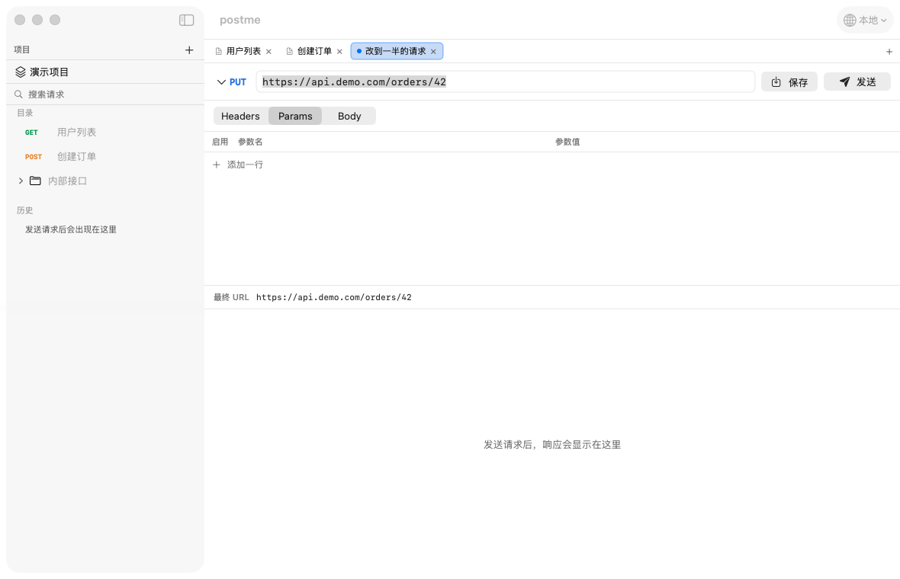

# postme

**English** · [简体中文](README.zh-CN.md)


A **lightweight native macOS API client** — an alternative to ApiPost / Postman.

It has exactly one goal: give back the memory those tools keep resident.



---

## Why this exists

ApiPost stays open all day and uses a lot of memory. Tauri was tried, but like Electron it
embeds WKWebView on macOS — the WebKit content process alone costs tens to over a hundred MB,
so nothing is saved.

So this app uses **no WebView at all**: SwiftUI draws the interface, `URLSession` sends requests.
The cost is macOS-only; the payoff is an order-of-magnitude difference in memory.

### Measured memory

| | postme | ApiPost |
|---|---|---|
| Physical footprint (phys_footprint) | **~40 MB** | 288 MB (peak 424 MB) |
| Processes | 1 | 5 (RSS total 261 MB+) |
| Install size | 2.1 MB | — |

> Measurement note: these are **phys_footprint** values as shown in Activity Monitor, not `ps` RSS.
> postme's RSS is about 116 MB, but most of that is pages shared with system frameworks — RSS counts
> shared libraries once per process, which badly distorts comparisons between similar apps.
> phys_footprint is the honest number.

---

## Features

### Request debugging
- Methods: GET / POST / PUT / PATCH / DELETE / HEAD / OPTIONS
- Headers and query parameters (each row can be enabled/disabled)
- **RESTful path variables**: `{id}` / `:id` in the URL automatically appear under Path Parameters
  in the Params pane; values support `{{variables}}` and are encoded as a single path segment
- **Auth tab**: Bearer Token / Basic Auth / API Key (in a header or query parameter); fields
  support `{{variables}}`, auth is applied before sending, an explicit header/parameter with the
  same name always wins, and the structure is preserved when exporting to Postman
- **Cookies tab**: manual cookie rows plus a session cookie jar (off by default). When enabled,
  `Set-Cookie` values are kept in memory and sent back per domain / path / Secure / expiry; quitting
  clears them
- Request bodies: JSON, raw text, form URL-encoded, multipart form (text and file fields),
  binary file (sent verbatim), none
- **File uploads**: multipart file fields and binary bodies; 64 MB per file, with path and
  readability checked before sending; cURL / Postman import and export keep file paths
- Responses: status code, headers, body (JSON auto-pretty-printed, read-only syntax highlighting,
  switchable between formatted (tree) / minified)
- **Find in response** (`⌥ ⌘ F` or the magnifier in the body toolbar): uses the system find bar with
  match count and previous / next
- **Response examples**: save the current response as an example (2 MB body limit) and view / copy /
  delete examples per request; stored in `examples.json`, written only on explicit save
- **JSON tree view** — the formatted pane is the tree; collapse and expand by level, per-node
  toggles plus expand-all / collapse-all; key order matches the raw response
- **JSON syntax highlighting while editing** — keys, strings, numbers and literals in distinct
  colors; highlighting is debounced so typing stays responsive
- **Cancellable** — interrupt an in-flight request at any time (button or `⌘.`); cancelling is not a
  failure and is not recorded in history
- **Bounded response memory** (16 MB): huge responses cannot exhaust memory; truncation is stated
  explicitly
- **Phase timings**: DNS / TCP connect / TLS handshake / time to first byte (TTFB) / download
- Request history (recorded automatically, restorable to the editor): pinned at the **bottom left**
  of the sidebar, collapsed by default; click the header to expand. The expanded state is kept in
  settings, and clearing the history asks for confirmation
- **Copy as cURL** (`⌥ ⌘ C`; also an icon button in the request bar and an entry in the sidebar's
  context menu): copies the request as a command line with variables substituted from the active
  environment. It is built from the same URL assembly and body encoding as the send path, so the
  pasted command sends what the app would send — including which redirection/certificate behaviour
  is in effect
- **Multi-tab editing**: the tab bar's `+` menu opens a new request or imports a cURL command, each
  into its own tab. Every open request gets its own tab with its own draft, unsaved marker,
  request/response pane selection and response — opening another request never replaces what you
  are typing, so the old "save / discard / cancel" prompt is gone. Closing a tab with unsaved
  changes asks first (save and close / discard / cancel). The tab context menu offers Duplicate Tab,
  Close, Close Other Tabs and Close All Tabs; Duplicate copies the current draft (unsaved edits
  included) into a new tab next to it, owned by no saved request, so saving it creates a new
  request instead of overwriting the original. When a batch contains dirty tabs it asks once
  (discard and close / cancel) instead of prompting per tab. Sending and cancelling are **per tab**:
  a slow request in one tab keeps running while you send in another, and "cancel" only interrupts
  the tab you are looking at. Tabs (each with its draft and, if it has one, the saved request it
  belongs to) are debounced to disk, so a crash does not lose them
- **Server-Sent Events (`text/event-stream`)**: when the response is an event stream the app
  recognises it from `Content-Type` and shows events as they arrive instead of waiting for the
  stream to end. A dedicated **Events** pane lists each event with its sequence number, event type
  badge, `id`, arrival time and data (copyable per row), and follows the tail automatically. Frames
  are split per the SSE spec (`data:` / `event:` / `id:` / comments / multi-line data, CRLF, LF or
  CR), the stream can be cancelled at any time with the events received so far kept, and at most
  2000 events are retained (older ones are dropped and the count is shown). Non-SSE responses behave
  exactly as before. **The timeout is an idle timeout**: a long stream keeps running as long as the
  server keeps sending, but if the server goes silent for longer than the configured seconds the
  stream is interrupted — raise the setting when needed. There is no automatic reconnection.
- **Model output (SSE only)**: when the response is SSE, an extra **Model Output** pane joins one
  field's deltas into a continuous text in arrival order, so you no longer have to eyeball dozens of
  `delta.content` events. **The main area joins exactly one selected field**; every other joinable
  field is listed collapsed (name, size, piece count, expandable to its joined text), and the choice
  follows the tab. Three built-in path sets: **OpenAI**
  (`choices[i].delta.{content, reasoning_content, reasoning, tool_calls[j].function.arguments}`),
  **Anthropic** (`content_block[i].{text, thinking, partial_json}`) and
  **LangChain / LangGraph** (`response.blocks[i].{text, thinking, input}` and `response.content`),
  plus **custom paths** (keys and
  `[index]` only, e.g. `choices[0].delta.custom`; add or remove them in the pane or in Settings, up to
  16). LangChain streams carry a **whole snapshot per step** rather than deltas, so that path set
  replaces a field when the new value extends the previous one and ignores exact repeats — the same
  answer is never joined twice. A single field is capped at 512 KB (marked and stopped) and at most 64
  fields are kept (dropped fields are counted and shown). Every other pane and the default landing tab are unchanged — an SSE
  response still ends on **Events**.

### Project management (ApiPost-style project layer)
- **Project switcher** at the top of the sidebar: one project in focus, the tree shows only it
- Create / rename / delete projects — all three live in the project switcher's menu, so the sidebar
  `+` stays scoped to the current project: it creates a folder, nothing else. **New request** and
  **import cURL** live in the tab bar's `+` menu instead, because both of them produce a new tab
  rather than something inside the project you happen to be looking at. Deleting a
  project removes all folders and requests and cannot be undone; at least one project is kept
- Nested folders inside a project; rename and delete; promote a top-level folder to a project
- **Drag to organise**: drag requests/folders to reorder among siblings; drop on the middle of a
  folder to move it inside; a folder cannot be dropped into its own subtree
- **Save**: if the **active tab** belongs to a saved request, `⌘ S` overwrites it in place (the
  ownership is persisted with the tab, so after a restart it still overwrites instead of creating a
  duplicate); otherwise a sheet asks for a name — the target project defaults to the current one,
  and both project and folder can be changed
- Search by name/URL within the current project
- **OpenAPI / Swagger import** (`⌘ ⇧ O`): **Swagger 2.0 and OpenAPI 3.x JSON files**; tags become
  folders; path / query / header / cookie parameters, JSON / form / multipart bodies,
  bearer / basic / apiKey auth and servers / host become a `baseUrl` environment; a preview lists
  counts and warnings before importing. Local files only; no response docs, Mock or two-way sync
- **Postman Collection v2.1 import/export** (ApiPost, Postman and Insomnia all export this format)
- Each imported collection becomes a **project with the same name** and is activated; export covers
  the **current project**
- An **Import** menu at the top of the sidebar collects OpenAPI / Postman / cURL imports and project
  export; the system menu keeps the same actions with shortcuts
- Authentication is preserved on import: bearer / basic / apikey are materialized as equivalent
  headers or query parameters; auth types that cannot be reconstructed statically (oauth2 and
  friends) are listed in the import result instead of being silently dropped
- **cURL import** (`⌘ ⇧ V`): paste a browser/Postman "Copy as cURL" command or a terminal command.
  The target defaults to the **current project** (a new project is one click away); multiple
  commands and `--next` segments each become their own request, and the first imported request is
  opened right away, so the next step is sending it
- Legacy `workspace.json` migrates automatically: old top-level collections are wrapped in a single
  "默认项目" project with node IDs preserved

### Environment variables
- Multiple environments; `{{name}}` substitution applies to URL, headers, parameters and body
- Built-in dynamic variables (no definition needed):

  | Variable | Value |
  |---|---|
  | `{{$timestamp}}` | current Unix seconds |
  | `{{$isoTimestamp}}` | ISO 8601 timestamp |
  | `{{$uuid}}` | UUID |
  | `{{$randomInt}}` | random integer |

> Undefined variables are **left as-is** and flagged in the UI; they are never silently replaced
> with an empty string.

### Language
- Switch between **System / 简体中文 / English** in Settings; the change applies immediately and is
  persisted
- All interface text, menus, dialogs, import warnings and error messages follow the selected
  language

### Roadmap
See [docs/ROADMAP.md](docs/ROADMAP.md) for the feature gap against ApiPost, the priority ranking
and the planned milestones.

### Explicitly out of scope
Accounts, cloud sync, pre-request scripts and assertions, team collaboration.

---

## Build and run

### Requirements
- macOS 14.0 or later
- Xcode or a Swift toolchain (developed and verified with Swift 6.3 / Xcode 26)
- On this Mac, the bundle script defaults to the macosx26.5 SDK because the 27.0 command-line SDK lacks the SwiftUI macro plugin. Set `SDK=macosx27.0 make app` to override it.

### Commands

```bash
make app     # build and bundle build/postme.app (ad-hoc signed)
make open    # bundle, then open via LaunchServices (menu bar and focus behave correctly)
make run     # run directly for development (debug; AppDelegate activates the app)
make build   # compile only
make cli     # compile and create the build/postme CLI entry point
make clean   # remove build products
```

After the first build, drag `build/postme.app` into Applications for daily use.

### Command-line interface

The same executable contains both interfaces: no arguments launches the GUI; any command selects
the headless CLI. `make cli` creates the convenient `build/postme` entry point (the bundled app also
exposes it as `build/postme.app/Contents/MacOS/postme`).

```bash
build/postme --help
build/postme project create "My project"
build/postme import openapi ./openapi.json --new-project "Demo API"
build/postme import postman ./collection.json       # always creates a project
build/postme import curl ./request.curl --project "Demo API"
cat ./request.curl | build/postme import curl - --new-project "From stdin"

build/postme --json project list
build/postme --json request list --project "Demo API"
build/postme request show <request-uuid>
build/postme environment create Development
build/postme environment set Development baseUrl https://localhost:8080
build/postme export postman "Demo API" --output ./collection.json
build/postme request delete <request-uuid> --yes
```

- OpenAPI defaults to a new project; `--project` merges it as a folder. cURL defaults to the active
  project's root. Postman import keeps the GUI behavior and always creates a project.
- Projects and environments accept an exact name or UUID; duplicate names must be disambiguated by
  UUID. Request commands use the collection-node UUID printed by `request list`.
- `--json` makes command results stable and machine-readable. Export writes the Postman JSON itself
  to stdout when `--output` is omitted or `-`.
- `--data-dir <dir>` (or `POSTME_DATA_DIR`) overrides the normal data directory, which is useful for
  isolated jobs and tests. All writes are synchronous. Exit codes are `0` for success, `1` for an
  operation failure, `2` for invalid usage and `3` for a workspace concurrency conflict. With
  `--json`, errors also carry a stable `code` (`workspace_busy` or `workspace_conflict`) alongside
  `error` and `exitCode`. Deleting data or clearing history requires `--yes`.
  `POSTME_DATA_DIR` also applies to the GUI, which otherwise ignores `HOME` overrides.
- Run `build/postme <command>` for projects, requests, environments and history. Environment
  commands also support `use`, `deactivate`, `unset` and `delete`.

> **Concurrent writes are rejected, never silently merged.** GUI and CLI take a short exclusive
> lock only while writing and compare a disk fingerprint before every write (optimistic CAS). A
> write command that finds the workspace busy or changed on disk fails with exit code 3 and
> **writes nothing** — retry it once the other process is done. Read-only commands are unaffected,
> though they may see a snapshot that is inconsistent across the four JSON files (each individual
> file is still written atomically). The GUI checks for external changes when it becomes active
> and reloads; if you have unsaved edits it asks before discarding them.

> **Why not just `swift run`**: a bare binary launches as an accessory process — the window is not
> brought forward and there is no application menu. `NSApplicationDelegateAdaptor` provides an
> activation fallback, but the `.app` bundle is the normal way to run it.

### Zero dependencies

`Package.swift` declares no `dependencies`. Everything is built on Foundation / SwiftUI / AppKit.

---

## Usage notes

### Keyboard shortcuts

| Action | Shortcut |
|---|---|
| Send request | `⌘ ↩` |
| Cancel request | `⌘ .` |
| Save request | `⌘ S` |
| New request | `⌘ N` |
| Search requests | `⌘ F` |
| Find in response | `⌥ ⌘ F` |
| Import cURL | `⌘ ⇧ V` |
| Copy as cURL | `⌥ ⌘ C` |
| Import OpenAPI / Swagger | `⌘ ⇧ O` |
| Import Postman / ApiPost collection (new project) | `⌘ ⇧ I` |
| Export project | `⌘ ⇧ E` |
| Settings | `⌘ ,` |

### Data storage

State lives in four JSON files in one directory, split by **how often it changes**:

```
~/Library/Application Support/postme/
├── workspace.json   projects (with folder trees), environments, settings
├── tabs.json        open tabs (draft + baseline + owning request)
├── history.json     request history (max 200 entries, each a request snapshot)
└── examples.json    response examples (per request, written only on explicit save)
```

**Why split**: every keystroke in the editor triggers a save. With a single file each save had to
re-encode all 200 history entries including their bodies — measured at 132 ms encode + 87 ms atomic
write for a 50 MB workspace, on the main thread, so typing stalled once the file grew. Split, typing
only rewrites `tabs.json` (KB-sized) and history is written only after a send; files whose content
has not changed are skipped entirely (compared by content — no rewrite, no mtime change).

Writes are debounced by 600 ms and flushed synchronously on quit. All four files are readable text,
so they can be backed up or versioned with git.

Migration and tolerance:

- A **single-file** workspace from v4 or earlier (tabs and history inside `workspace.json`) loads as
  before and is split into three files on the first save; the old `tabs` / `history` keys disappear
  from the core file;
- a top-level `collections` key is migrated into a single "默认项目" project with node IDs
  preserved; files from before tabs (`draft` + `draftNodeID`) migrate into **one tab**; when a
  sidecar file exists it wins and the legacy keys are ignored;
- **decoding is tolerant**: missing fields, wrong types and unknown enum values fall back to
  defaults, and a single bad node or tab only drops itself;
- a corrupt file is backed up **by itself** (`workspace.json.corrupt-<timestamp>`, numeric suffix on
  collision) while the other files still load. If the backup itself fails, the original file is left
  untouched and is never overwritten by an empty workspace.

### Debugging intranet services

`Info.plist` enables `NSAppTransportSecurity → NSAllowsArbitraryLoads`.
**This is required** — otherwise requests to `http://localhost` or `http://192.168.x.x` are blocked
by ATS, and the resulting error is hard to diagnose.

For HTTPS services with self-signed certificates, turn on the corresponding switch in
Settings → "Skip HTTPS certificate validation (self-signed)" (it affects TLS validation only and is off by
default).

---

## Design notes

A few non-obvious decisions that came out of real bugs:

**Encoding is done by hand, not by `URLComponents`.**
Foundation does **not** encode `+` when serializing query items. Under the form-urlencoded
convention used by PHP, Java servlets, Python `parse_qs`, Rails and many other servers, `+` in a
query or form value decodes to a **space** — so `+8613800138000` silently becomes " 8613800138000".
Silently altering user input is unacceptable in an API client, so `FormEncoding` encodes values
itself and excludes `+`, along with `& = ? # %`, from the allowed set.

**The "final URL" preview must equal the final URL.**
The preview and the send path used to have separate implementations, and they diverged twice:
first on encoding (the preview showed `+`, the server received `%2B`), then on variable
substitution (the preview encoded `{{baseUrl}}` as `%7B%7BbaseUrl%7D%7D` while the actual request
used the substituted address). The preview now runs the whole pipeline: **`AppState.resolveDraft`
substitutes variables, then `RequestExecutor.previewURL` merges and encodes the query** — the same
entry point as sending, so the two cannot structurally disagree.

**`URLSession` strongly retains its delegate.**
The delegate is the executor itself, forming an `executor → session → executor` cycle, so `deinit`
never runs. Rebuilding the executor after a settings change must call `invalidate()` explicitly;
otherwise every change leaks a session.

**Text controls must disable every "smart" substitution.**
macOS smart quotes turn a straight `"` in JSON into a curly `”`, silently corrupting the request
body in a way that is very hard to trace. `CodeTextView` disables smart quotes, dashes, text
replacement, spelling correction, continuous spell checking, grammar checking, link detection, and
smart insert/delete — eight switches in total.

**The bundling script must sign last.**
Signing before modifying `Info.plist` invalidates the signature, and the system SIGKILLs the app on
launch.

**Large responses must not block the main thread.**
Bodies over 2 MB are truncated for display, and syntax highlighting is skipped above 1 MB (the same
applies to request bodies). The text view decides whether to update from a cached written value
instead of reading `textView.string`, because that accessor materializes the entire text storage
into a new string on every call.

**"Low memory" cannot be a display-layer trick.**
The display threshold only bounds the text that is rendered, not memory — a measured 120 MB
response took the process from 2 MB to 147 MB, erasing exactly the advantage this project exists
for. So the transport layer has its own 16 MB hard cap: once exceeded it stops accumulating,
cancels the task, and surfaces the fact that the data itself is incomplete (`isBodyTruncated`).
Truncated JSON is no longer pretty-printed — that always fails, and falling back to the raw prefix
would suggest the response ended there.

**Truncation and user cancellation share the same underlying error code.**
Both surface as `NSURLErrorCancelled`, so they must be distinguished by explicit flags: truncation
returns a **partial response** with an honest marker, while user cancellation returns silently to
idle with no error and no history entry. Relying on `URLError` alone necessarily gets one of them
wrong.

**Workspace decoding must be tolerant, but tolerance has a floor.**
Compiler-synthesized decoding failed the entire `workspace.json` whenever any non-optional key was
missing; the file was then moved to `.corrupt-*` and the app started empty — collections,
environments and history gone at once, triggerable by **adding a single field**. Every persisted
model now decodes explicitly and tolerantly. But the floor remains: the file must be a JSON object
containing at least one recognizable workspace key (`version` alone does not count — `{"version":7}`
must not be claimed), otherwise it is still treated as corrupt and backed up. Silently treating an
unrelated file as an empty workspace and then overwriting it on the next save is worse than an
error.

**A prompt that replaces the user's content is the wrong fix; removing the conflict is the right one.**
The first version of drafting kept a single editor buffer, so opening another request had to ask
"save / discard / cancel". That state machine had a subtle defect: the prompt rolled the sidebar
selection back to the node being edited, which fires `onChange` **again**, so the same logic ran a
second time and replaced the node the user actually clicked with the rolled-back one — after
choosing "save and continue" the user stayed put. A guard ("refuse new actions while one is
pending") fixed the symptom; **tabs removed the cause**: each open request keeps its own draft, so
nothing has to be thrown away and there is no prompt to get wrong. The lesson survives the rewrite:
`handleSidebarSelection` is still the single entry point for sidebar selection so the
selection-change path can be driven by tests, and the close-confirmation dialog is split into
"dialog dismissed" (presentation only) and "cancel" (drops the pending target) — collapsing those
two into one callback silently broke "save and close", which a test now pins.

**Per-tab requests need per-tab cancellation, and results must be written back by identity.**
With several requests in flight at once, "cancel" can no longer mean "cancel everything" — the user
is looking at one tab, and killing another tab's request would lose work they cannot even see. The
executor therefore tags each task with the tab that started it (`send(_:token:)` / `cancel(token:)`).
The same reasoning applies to results: `send()` captures the tab id **before** awaiting and writes
the response back by id, dropping it if that tab is gone — writing to "the current tab" would show
a response next to a request that never produced it, which is the single most misleading thing a
debugging tool can do.

**Postman import must not be all-or-nothing, and must not silently drop auth.**
`auth` is a first-class v2.1 field; ignoring it leaves every request in a Bearer-authenticated
collection returning 401 and the user concludes the tool is broken. Types that can be expressed
statically (bearer / basic / apikey) become equivalent headers or query parameters; types that need
dynamic signing (oauth2 and others) are listed in the import result instead of being pretended
away. Decoding is equally tolerant: `request` may be a string and `header` may be a raw string
block (both are allowed by the schema), and one malformed item should only affect itself, never
reject the whole file.

**cURL import targets byte-identical server behavior, not "looks similar".**
Commands are copied verbatim and users cannot see how postme understood them, so the only valid
criterion is what gets sent. That leads to several counter-intuitive choices: `-d` keeps curl's
implicit `Content-Type: application/x-www-form-urlencoded` even when the payload is bare JSON
(switching to `application/json` would change the server's parser); `--data-urlencode` values are
treated as **literal text** and are not percent-decoded first (curl encodes `%` along with
everything else, so decoding would remove one layer of escaping); under `-G`, both `-d` and
`--data-urlencode` go into the query. Global options that cannot travel with a request (`-k` /
`-L` / `-m` / `-x`) always appear in the warnings — silently ignoring them would make the import
look complete until the request is sent.

**Exporting back to curl applies the same criterion in reverse: the command must send what postme
sends.** The command is assembled from the same URL builder (`previewURL`) and the same
implied-`Content-Type` table as the send path, and only enabled rows with a non-empty key are
emitted — `CurlCodec.decode(CurlExport.command(for: r))` is asserted to round-trip in tests. Four
flag choices are deliberate, each pinned by a test:

- `--data-raw` instead of `-d`: curl reads a file for `-d '@path'`, so a body that starts with `@`
  would be silently replaced (or fail) when pasted.
- `--form-string` instead of `-F`: with `-F`, `@` / `<` / `;` inside a value are part of curl's
  multipart syntax, so a text field such as `note=a;b=x` would arrive as `a`.
- `-X GET` only when a GET actually carries a body: curl switches to POST when data is present, and
  `-X HEAD` makes curl wait for a body a HEAD response never has (HEAD without a body uses `-I`).
- no hand-written multipart `Content-Type`: curl must generate its own boundary, otherwise the
  header and the body disagree.

Values containing control characters are quoted in ANSI-C form (`$'...'`), which survives a trip
through a JSON-based clipboard instead of being flattened; `-L` / `-k` are emitted only when the
app's own settings have them enabled, so the command describes this app's behaviour for this
request rather than an idealized one.

---

## Project layout

```
Sources/Postme/
├── PostmeApp.swift          process entry (GUI / CLI dispatch) + AppDelegate + menu commands + Settings
├── AppState.swift           top-level state container (@MainActor @Observable) + open-tab state machine
├── CLI/                     headless command parser + synchronous workspace import/data operations
├── Models/                  plain data: requests, responses, projects, collection tree, environments, history, workspace
│   ├── EditorTab            one open tab: draft, baseline, owning node, per-tab runtime state
│   ├── Project              project layer (top-level container; migration target for legacy collections)
│   └── TolerantDecoding     tolerant-decoding helpers for persisted models
├── Services/                pure logic, Foundation only
│   ├── RequestExecutor      URLSession execution + task metrics + self-signed certs + response cap + cancellation
│   ├── FormEncoding         percent-encoding for query/form components
│   ├── VariableResolver     {{var}} substitution
│   ├── PostmanCodec         Postman v2.1 import/export (auth materialization, tolerant decoding)
│   ├── CurlCodec            cURL command parsing (quotes / line continuations / multiple commands / --next)
│   ├── CurlExport           request → curl command (same URL/body assembly as the send path)
│   ├── Localization         language model and string tables
│   ├── JSONTree             order-preserving JSON parser + tree row model (used by the tree view)
│   └── PersistenceService   three-file store (core/tabs/history) + per-section diff + debounce + synchronous flush + corrupt-file backup
├── Views/                   SwiftUI interface
└── Components/              reusable controls (code text view, key-value editor, JSON highlighter)

Tests/PostmeTests/           test suite (including response-cap and cancellation cases over real sockets)
```

`Models/` and `Services/` deliberately do **not** import SwiftUI. The logic layer compiles without
the UI, which makes it suitable for both `swift test` regression runs and one-off CLI verification.

**Why tests live in the repository**: v1 kept its verification assertions in throwaway programs under
`/tmp`, outside version control — so any change had no regression net and a refactor could silently
undo a fixed behavior. They are now part of `Tests/PostmeTests/` and run with `swift test`.

---

## Known limitations

- **History stores the unresolved template** (with `{{var}}` intact); this avoids writing plaintext
  secrets to disk, at the cost of showing templates rather than actual values in history.
- **OpenAPI / Swagger import supports JSON and local `$ref` only**: YAML, external refs, response
  docs, OpenAPI export, Mock and two-way sync are not implemented.
- **Path parameter values are encoded as a single path segment**: `/` becomes `%2F`; edit the URL
  directly when you need a multi-segment value.
- **JSON pretty-printing uses `JSONSerialization`, which does not preserve key order.** The tree
  in the formatted pane uses its own order-preserving parser on the raw response (up to 2 MB), so
  it follows the original order; Copy still outputs pretty-printed text.
- **The tree is unavailable when the response was truncated, exceeds the 2 MB display limit, or
  has more than 200k nodes** (it says so and falls back to text).
- **`⌘F` is bound to sidebar search**; `⌥⌘F` opens the response find bar.
- **When a URL contains a hand-typed query and the parameter table also has entries, export/import
  prefers the parameter table.** The send path is unaffected (both are merged correctly).
- **The response body retention cap is 16 MB**: past that, reception stops and the response is
  marked truncated (saving bandwidth and time) rather than being fully read into memory. Smaller
  responses are unaffected.
- **Postman auth import is static materialization only**: bearer / basic / apikey become equivalent
  headers or query parameters; oauth1 / oauth2 / digest / awsv4 / hawk / ntlm / edgegrid require
  dynamic signing and cannot be reconstructed on import — they are listed in the import result
  rather than silently dropped.
- **Folders cannot be moved between projects**: v1 only offers a one-way "promote top-level folder
  to project".
- **Postman import always creates a new project** (it cannot merge into the current one); cURL
  import supports both.
- **cURL import covers only what can be reconstructed statically**: global options (`-k` / `-L` /
  `-m` / `-x` / client certificates), `-F key=@file` file fields and `@file` body reads cannot
  travel with a request and are reported in the import result rather than silently dropped. The
  same applies to the `name@file` / `@file` forms of `--data-urlencode`.
- **cURL export writes auth as headers rather than as `-u` / `--oauth2-bearer`.** The app stores what
  to send, not how it was configured, so the command carries the materialized `Authorization` (or
  apikey) header or query parameter: byte-identical on the wire, but a secret that travels in a
  header is visible in the command line and in shell history. Multipart file fields are disabled
  placeholders and are not exported, and `-L` / `-k` appear only when the app's settings enable them
  — a command copied with "follow redirects" off will not follow them.
- **The pasted command and the app differ in transport defaults that neither side declares.** The
  parity run compared every declared header, and they match; but curl sends `Accept: */*` and no
  `Accept-Language`, while URLSession adds the system locale's `Accept-Language` (its
  `Accept-Encoding` may differ too). A server that negotiates content could therefore answer
  differently to the same request. Nothing in the request model can express these, so the command
  cannot carry them.
- **The app itself cannot send "GET with a body"**: URLSession rejects it with `-1103`, while the
  exported `-X GET --data-raw ...` is sent by real curl. That is a transport-layer limit, not the
  exporter diverging from the send path (the parity harness records both sides).
- **cURL import models the query as key-value pairs**: spaces encode as `%20` (curl uses `+`), and
  hex casing differs; after decoding `application/x-www-form-urlencoded` the result is equivalent to
  curl, but services that validate signatures over the **raw query string** may not agree. In
  addition, a literal `+` in the URL (`?q=a+b`) decodes to a space per form conventions, unlike
  strict RFC 3986 parsing — a structural consequence of modeling the query as key-value pairs.
- **Environments are global** and do not switch with projects (per-project environment isolation is
  not implemented).

## Verification status

- `swift test`: **all tests green** (`Tests/PostmeTests/`)
  - Covers variable substitution, Postman codec round-trips, collection trees, persistence, URL and
    request-body assembly, preview/send parity, workspace schema tolerance and legacy migration,
    project-layer state machine, response cap and cancellation, Postman auth and tolerant import,
    tab editing (per-tab drafts and dirty state, close confirmation, save targeting the active tab,
    tab persistence and v3→v4 migration), cURL parsing / import persistence / export round-trips
    (including the flags that keep the emitted command faithful), and localization
    completeness
  - Response-cap and cancellation tests use a **real socket** (`LocalHTTPServer`), not mocks
  - `JSONHighlighterTests` covers the highlighting contract: distinct colors for keys / values /
    numbers / literals, escaped quotes do not terminate strings early, **highlighting changes not a
    single byte of the text**, highlighting works while editing, size-limit skipping, debounce and
    cancellation while editing, and JSON ↔ raw-text toggling (driven through a real SwiftUI host —
    see below)
- Editing-time highlighting cost was **measured** (throwaway program, not in the repo): highlighting
  is an O(n) attribute scan, about 10 ms for 200 KB; editing therefore uses a 150 ms debounce, while
  read-only response bodies are highlighted once.
  Measurements also confirmed that attribute writes do not enter the undo stack, do not fire
  `textDidChange`, and that typed characters do not inherit colors, so editing-time highlighting
  does not interfere with typing or `⌘Z`.
  One highlighting-toggle regression **only reproduces in a hosting view** (switching to raw text
  left stale colors), so that case is driven through `NSHostingView` rather than by calling the
  coordinator directly — the direct version passes even with the fix removed.
- The cURL parser was compared **byte-for-byte against real `curl`**: 18 representative commands
  (browser Copy as cURL, Windows/PowerShell continuations, `-G`, `-G -F`, multipart, `-u` / `-b` /
  `--oauth2-bearer`, ANSI-C quoting, `--next`, bare-JSON `-d`) were sent both by curl and by postme
  against a local echo server, comparing method / path / body / headers. All semantic items match;
  only three **intentional** representation differences remain (equivalent after server-side
  decoding): space encoding `%20` vs `+`, hex casing, and multipart boundary values.
  That comparison script is a throwaway program (not in the repo); the same assertions are pinned in
  the repository by `CurlCodecTests`.
- **The exporter was checked against real `curl` the same way** (throwaway harness, deleted
  afterwards): 8 requests — a query with spaces / `+` / CJK, a JSON body with newlines, quotes, `$`
  and backticks, form-urlencoded with `&` and `+`, multipart with `;` and `@` inside the values, a
  DELETE with a JSON body, raw text starting with `@`, and an empty JSON body — were sent **by
  running the generated command through real curl** and through postme's own send path, against a
  local echo server, comparing method / path / headers / body. Every compared item matches; the only
  difference is the multipart boundary, which each side generates for itself (the parts themselves
  match). One case is a recorded, deliberate mismatch: the app cannot send a **GET with a body**
  (URLSession rejects it with `-1103`) while curl sends it — see Known limitations.
- **Copy path** (throwaway check, deleted): `FileActions.copyAsCurl` was driven against the real
  `NSPasteboard`, and the clipboard content is exactly `curlCommand(for:)` for that request — paste
  it back through `CurlCodec` and method / URL / headers / JSON body come back. Negative controls for
  this feature: switching `--data-raw` back to `-d`, dropping the implied `Content-Type`, switching
  `--form-string` back to `-F`, and removing the import panel's auto-open each make the corresponding
  test fail.
- **Real app, exported entry point**: the release bundle was launched against a seeded workspace
  (three tabs, one with unsaved edits), the window was captured and read back with Vision OCR, and
  the request bar renders the copy-as-cURL **icon only** — the label no longer takes up bar width
  (the text lives in the tooltip and accessibility label); switching the `Image` back to a `Label`
  makes that test fail.
- `swift build -c release`: zero warnings, zero errors
- CLI: three `CLIWorkspaceTests` cover import/environment persistence, project activation with dirty
  tabs (including a real `AppState` launch), request deletion and last-project protection. An isolated
  end-to-end run also exercised all three import formats, request/project/environment/history operations,
  Postman export, destructive-command confirmation and exit codes. `swift test` currently runs
  **431 tests** (8 skipped, 0 failures) on macOS CI.
- Localization: `LocalizationTests` asserts that both string tables
  cover every key, that format placeholders match between languages (including `%.1f`), that the
  English table contains no CJK characters, that a language change is observable (the mechanism
  behind menu-bar recomputation), that the choice round-trips to disk, that cached response text is
  recomputed, and that the untitled-name placeholder is recognized in **both** languages — that last
  one is the failure mode where only the literal changes and the equality check does not, which
  compiles, passes a naive grep and still misnames history entries.
  A scan for user-visible Chinese string literals in `Views/`, `AppState` and `PostmeApp` returns
  zero hits; the remaining Chinese literals are tolerant-decoding defaults for persisted models, the
  legacy migration project name, and the language's own display name.
- Real app process: a legacy `workspace.json` with missing fields loads correctly with data intact
  and produces no `.corrupt-*`; unrelated JSON is still treated as corrupt and backed up
- **Tab bar, verified on the running app**: the release bundle was launched against a seeded v4
  workspace (three tabs — two bound to saved requests, one with unsaved edits), its window was
  captured with `screencapture -l <window id>` and the pixels were read back with Vision OCR. The
  OCR output contains the three tab titles with their close glyphs, the unsaved marker on the third
  tab, and the third tab's own content (`PUT https://api.demo.com/orders/42`) in the editor — i.e.
  restoration from disk, the dirty marker and the active-tab wiring render as designed. Clicking is
  still not exercised (see below).
- **Menus, read in-process** (throwaway probe, deleted afterwards): hosting `EditorTabBar` and
  `SidebarView` in real windows and opening the `+` menus prints the NSMenu titles —
  `["新建请求", "导入 cURL 命令…"]` for the tab bar, while the sidebar `+` is a plain button with
  **no** menu (its click presents the new-folder sheet, window.attachedSheet) and the project
  switcher keeps its own project menu. SwiftUI builds menu items only at presentation time, so this
  read required really popping the menu.
- **Editing a key-value row (Params / Headers / form fields) and then switching tabs crashed the
  app** — `Fatal error: Index out of range`, stack `PlatformTextFieldCoordinator.controlTextDidEndEditing`
  → `Binding.subscript.getter` → `Array._checkSubscript`, i.e. SIGTRAP with no dialog. Root cause:
  rows were bound through `ForEach($items)`, whose element bindings are **index-based**; when the
  editor's array was swapped out (another tab) or shortened, the end-editing write-back still wrote
  to the stale index of the now-shorter array. Rows are now bound **by id**
  (`KeyValueEditor.binding(for:)`), so a row that no longer exists degrades to a no-op: no crash, and
  no leaking of one tab's row into another's. Pinned by `KeyValueEditingSafetyTests` (4 tests): real
  window + real AppKit focus + real field editing on the real `$app.draft.queryParams` chain,
  including a variant hosting the whole `ContentView`; the negative control (re-introducing an
  index-based binding) reproduces the SIGTRAP. The same class of binding had already been avoided in
  `EnvironmentEditor` (`bindingForEnvironment(id:)`); a sweep finds no remaining `ForEach($…)` or
  index-subscript binding in the app.
- Independent delivery review (round 1 REJECT → rework → round 2 REJECT → rework → round 3 PASS);
  round 2 blockers were "bare-JSON `-d` was changed to `application/json`" (violating the
  byte-parity criterion; fixed by keeping curl's implicit form type and adding a regression test)
  and "`-G -F` produced GET + multipart body" (curl actually ignores `-G`; aligned and tested);
  round 3 additionally noted "`-d ''` with an empty body lost Content-Type" (fixed under the same
  criterion). All three fixes have negative controls (reverting the fix makes the corresponding
  test fail).
- **Not verified**: clicking anything in the GUI (accessibility access is blocked on this machine, so
  automated clicking is impossible — and synthetic events are dropped as well; the screen is locked
  for part of the session, which blocks AX reads system-wide); the tab bar, the
  close-confirmation dialog and the other click paths are covered by the state-machine tests plus
  the OCR-verified render of the running app described above, but no button has been pressed by
  hand. The v3 project switcher, folder promotion and import/export wording
  likewise have logic-layer tests only, with no manual click-through. The same applies to the cURL
  import panel: `CurlCodec` and `AppState.importCurlRequests` are tested, but the **panel's click
  path (menu item → clipboard prefill → preview → import → alert) has not been exercised by hand**.
  Its `Import to` picker is likewise pinned by a constant-level test plus the state-level import
  tests, not by reading the selected segment off the screen (selection is not visible to OCR). For
  copy-as-cURL, everything except the button press is covered: the state produces the command, the
  generated command is executed by real curl in the parity run, and the pasteboard write was driven
  directly — but no button was clicked.
  Language switching has both layers: unit tests for string-table completeness, persistence and
  live recomputation, plus `GUILanguageRenderTests` — it renders the real Settings / request-editor /
  sidebar views in real windows, captures the window pixels, and reads them back with Vision OCR,
  asserting the visible text switches zh → en → zh on the **same** `AppState` instance (i.e. the
  views actually redraw, not just that the table is right). That test needs screen-recording
  permission and is therefore opt-in:
  `POSTME_GUI_VERIFY=1 swift test --filter GUILanguageRenderTests`.
  The picker itself was still not clicked by hand.

---

## License

[MIT](LICENSE) © 2026 caozeal
