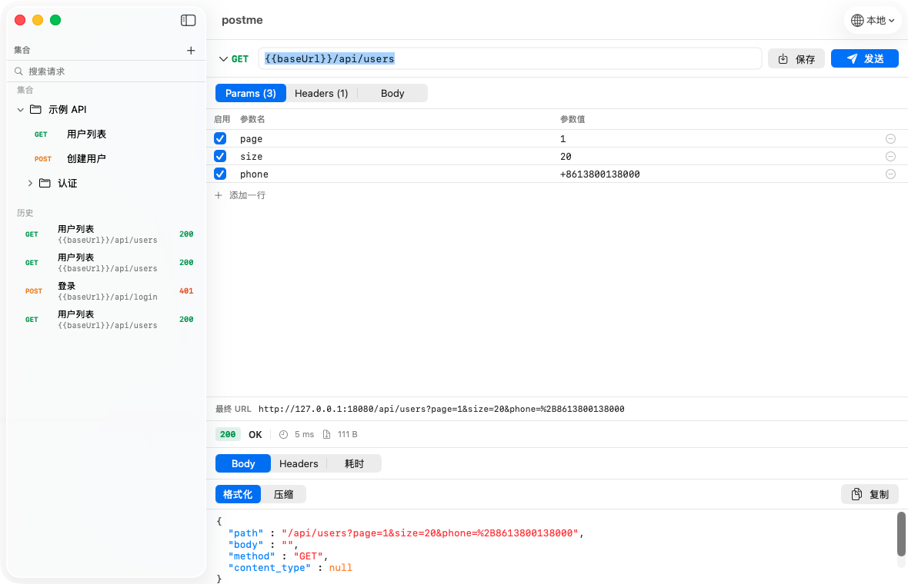

# postme

一个**轻量原生 macOS 接口调试工具**，ApiPost / Postman 的替代品。

目标只有一个：把那部分常驻内存还回来。



---

## 为什么会有这个项目

ApiPost 日常常开，内存占用偏高。尝试过 Tauri，但它和 Electron 一样要在 macOS 内嵌
WKWebView——光 WebKit 的内容进程就是几十到一百多 MB，省不掉。

所以这里**不用任何 WebView**：原生 SwiftUI 画界面，`URLSession` 发请求。
代价是只能跑在 macOS 上，换来的是数量级的内存差异。

### 内存实测

| | postme | ApiPost |
|---|---|---|
| 物理内存（phys_footprint） | **约 40 MB** | 288 MB（峰值 424 MB） |
| 进程数 | 1 | 5（RSS 合计 261 MB+） |
| 安装体积 | 2.1 MB | — |

> 测量口径说明：这里用的是 macOS 活动监视器显示的 **phys_footprint**，不是 `ps` 的 RSS。
> postme 的 RSS 约 116 MB，但其中大部分是与系统框架共享的页——RSS 会把共享库重复计入每个进程，
> 用来比较同类应用会严重失真。phys_footprint 才是真实占用。

---

## 功能

### 请求调试
- 方法：GET / POST / PUT / PATCH / DELETE / HEAD / OPTIONS
- Headers、Query 参数（可逐行启用/禁用）
- 请求体：JSON、Raw Text、Form URL Encoded、Multipart Form（文本字段）、无
- 响应：状态码、响应头、正文（JSON 自动美化 + 只读语法高亮）
- **可取消**：请求进行中可随时中断（按钮或 `⌘.`），取消不算失败、不记历史
- **响应体有驻留上限**（16 MB）：超大响应不会把内存吃满，超限时明确标注已截断
- **分阶段耗时**：DNS 解析 / TCP 连接 / TLS 握手 / 等待首字节(TTFB) / 内容下载
- 请求历史（自动记录，可恢复到编辑器）
- **草稿保护**：切换请求前若有未保存修改会先询问（保存并继续 / 放弃修改 / 取消）；
  编辑中的草稿也会防抖落盘，异常退出不丢

### Collection 管理
- 分组树（文件夹可嵌套）、重命名、删除
- 按名称/URL 搜索
- **Postman Collection v2.1 导入导出**（ApiPost、Postman、Insomnia 都能导出这个格式）
- 导入时保留认证：bearer / basic / apikey 会物化为等效 header 或 query 参数；
  无法静态还原的认证类型（oauth2 等）会在导入结果里明确提示

### 环境变量
- 多环境切换，`{{变量名}}` 替换作用于 URL / Headers / 参数 / 请求体
- 内置动态变量（无需定义）：

  | 变量 | 值 |
  |---|---|
  | `{{$timestamp}}` | 当前 Unix 秒 |
  | `{{$isoTimestamp}}` | ISO8601 时间 |
  | `{{$uuid}}` | UUID |
  | `{{$randomInt}}` | 随机整数 |

> 未定义的变量会**原样保留**并在界面上提示，不会被静默替换为空。

### 明确不做
登录 / 账号 / 云同步、请求前后脚本与断言、团队协作。

---

## 构建与运行

### 环境要求
- macOS 14.0 或更高
- Xcode 或 Swift 工具链（开发时使用 Swift 6.3 / Xcode 26 验证）

### 命令

```bash
make app     # 编译并打包成 build/postme.app（含 ad-hoc 签名）
make open    # 打包后用 LaunchServices 打开（菜单栏/聚焦最正常）
make run     # 开发期直接运行（debug，靠 AppDelegate 兜底激活）
make build   # 只编译，不打包
make clean   # 清理构建产物
```

首次构建后，把 `build/postme.app` 拖进「应用程序」文件夹即可日常使用。

> **为什么不直接 `swift run` 日常用**：以裸二进制启动时进程是 accessory 姿态，窗口不会置前、
> 也没有应用菜单栏。代码里用 `NSApplicationDelegateAdaptor` 做了激活兜底，但正式使用还是
> 走 `.app` 更正常。

### 零依赖

`Package.swift` 里没有任何 `dependencies`。所有功能都由 Foundation / SwiftUI / AppKit 实现。

---

## 使用要点

### 快捷键

| 操作 | 快捷键 |
|---|---|
| 发送请求 | `⌘ ↩` |
| 取消请求 | `⌘ .` |
| 保存到集合 | `⌘ S` |
| 新建请求 | `⌘ N` |
| 搜索请求 | `⌘ F` |
| 导入集合 | `⌘ ⇧ I` |
| 导出集合 | `⌘ ⇧ E` |
| 设置 | `⌘ ,` |

### 数据存储

全部状态存在**单个 JSON 文件**里：

```
~/Library/Application Support/postme/workspace.json
```

包含集合、环境、历史、设置，以及未保存的编辑中草稿。因为是可读的文本文件，
可以直接用 git 备份或版本管理。写入前有 600ms 防抖，退出时会同步落盘。

**解码是容错的**：缺字段、字段类型不符、未知枚举值都退回默认值，不会让整份文件作废。
文件损坏时会自动备份成 `workspace.json.corrupt-<时间戳>`（同名时自动加序号）并以空工作区启动，
不会静默丢数据；若备份本身失败，原文件会原地保留，绝不被空工作区覆盖。

### 调试内网服务

`Info.plist` 里开启了 `NSAppTransportSecurity → NSAllowsArbitraryLoads`。
**这是必需的**——否则调试 `http://localhost`、`http://192.168.x.x` 会被 ATS 拦截，
而且报错信息很难定位。

自签证书的 HTTPS 服务，在「设置 → 忽略 HTTPS 证书校验」里开启对应开关即可
（只影响 TLS 证书校验，默认关闭）。

---

## 设计说明

几个不那么显然、但踩过坑的决定：

**编码必须自己来，不能用 `URLComponents`。**
Foundation 序列化 query item 时**不会编码 `+`**。而按 form-urlencoded 规范，以及 PHP / Java Servlet /
Python `parse_qs` / Rails 等大量服务端的实际行为，query 与表单里的 `+` 会被解码成**空格**——
于是 `+8613800138000` 会静默变成「 8613800138000」。对一个接口调试工具来说，
静默篡改用户输入是不可接受的。所以 `FormEncoding` 自行编码，把 `+` 连同 `& = ? # %` 一起剔除出允许集。

**「最终 URL」预览必须真的等于最终 URL。**
预览曾和发送各写一套逻辑，结果两处都出现过分歧：先是编码不同（预览显示 `+`，服务端收到 `%2B`），
后是变量替换不同（预览把 `{{baseUrl}}` 编码成 `%7B%7BbaseUrl%7D%7D`，而实发的是替换后的地址）。
现在预览老老实实走完整流程：**先用 `AppState.resolveDraft` 做变量替换，再交给 `RequestExecutor.previewURL`
做 query 合并与编码**——与发送同一入口，从结构上不给分歧留空间。

**`URLSession` 会强引用它的 delegate。**
而 delegate 就是执行器自身，构成 `executor → session → executor` 的循环引用，
`deinit` 永远不会执行。切换设置重建执行器时必须显式 `invalidate()`，否则每次切换泄漏一个 session。

**文本控件必须关掉全部「智能替换」。**
macOS 默认的智能引号会把 JSON 里的半角 `"` 换成弯引号 `”`，静默损坏请求体且极难排查。
`CodeTextView` 里关闭了智能引号、破折号、文本替换、拼写纠正、连续拼写检查、语法检查、
链接检测、智能插入删除，共 8 项。

**打包脚本必须最后一步才 `codesign`。**
先签名、后修改 `Info.plist` 会使签名失效，App 启动时被系统直接 SIGKILL。

**大响应要防主线程卡死。**
超过 2 MB 的响应体截断展示，超过 1 MB 不做语法高亮；文本控件用缓存的已写入值判断是否需要
更新，而不是访问 `textView.string`（那个访问器每次都会把整个文本存储物化成新字符串）。

**「省内存」不能只做展示层。**
展示层的截断阈值只管显示文本，管不住内存——实测一个 120 MB 的响应会让进程占用从 2 MB 涨到
147 MB，正好把本项目的立身之本的差距抹平。所以传输层另设 16 MB 硬上限：超出即停止累积、
取消该 task，并把"数据本身没收全"这个事实（`isBodyTruncated`）透出到界面。
半截 JSON 不再尝试美化——美化必然失败，回退原文又会让人以为这就是全部响应。

**截断和用户取消底层是同一个错误码。**
两者最终都是 `NSURLErrorCancelled`，必须用显式标记区分：截断要返回**部分响应**并如实标注，
用户取消要静默回到空闲、不报错也不记历史。只靠 `URLError` 判断必然把其中一种做错。

**工作区解码必须容错，但容错要有底线。**
原先用编译器合成的解码，任何非可选键缺失都会让整份 `workspace.json` 解码失败，
随后被搬成 `.corrupt-*` 并以空工作区启动——集合、环境、历史一次性全没，
而**加一个字段就能触发**这条路径。现在所有持久化模型都显式容错解码。
但底线不能丢：文件必须是 JSON 对象且含至少一个能识别工作区的字段（`version` 不算，
单独一个 `{"version":7}` 不该被认领），否则仍判损坏走备份——把不相干的文件静默当成
空工作区、再被下次保存覆盖，比报错更糟。

**回滚 UI 状态本身会触发回调，能覆盖用户意图。**
草稿冲突提示要先把侧栏选中项回滚到当前编辑节点，可这个回滚会**再触发一次** `onChange`，
于是同一套逻辑被调用第二次，把用户真正点击的目标覆盖成"回滚后的节点"——用户选完
「保存并继续」后停在原地。修法是让状态机拒绝在已有挂起动作时接受新的动作。
这类缺陷的状态机单测全绿也发现不了：测试直调 `openSavedRequest`，绕过了 `onChange`
这个真实入口。所以侧栏选中变化的入口被收进 `AppState.handleSidebarSelection`，
让"回滚引发二次触发"这条链路能被测试直接驱动。

**Postman 导入不能 all-or-nothing，也不能静默丢认证。**
`auth` 是 v2.1 的一等字段，忽略它会让带 Bearer 的集合导入后所有请求 401——用户会以为工具坏了。
能静态表达的类型（bearer / basic / apikey）物化成等效 header 或 query 参数；
需要动态签名的类型（oauth2 等）明确列进导入结果，而不是假装没有。
解码同理：`request` 可以是字符串、`header` 可以是原始字符串块（schema 都允许），
单个畸形条目应该只影响自己，不该让整份文件被拒。

---

## 项目结构

```
Sources/Postme/
├── PostmeApp.swift          @main + AppDelegate 激活兜底 + 菜单命令 + Settings
├── AppState.swift           顶层状态容器（@MainActor @Observable）+ 草稿保护状态机
├── Models/                  纯数据：请求、响应、集合树、环境、历史、工作区
│   └── TolerantDecoding     持久化模型的容错解码辅助
├── Services/                纯逻辑，只依赖 Foundation
│   ├── RequestExecutor      URLSession 执行 + TaskMetrics 耗时 + 自签证书 + 响应体上限 + 取消
│   ├── FormEncoding         query / form 组件百分号编码
│   ├── VariableResolver     {{var}} 替换
│   ├── PostmanCodec         Postman v2.1 导入导出（含认证物化与容错解码）
│   └── PersistenceService   workspace.json 读写 + 防抖 + 同步落盘 + 损坏备份
├── Views/                   SwiftUI 界面
└── Components/              可复用控件（代码文本视图、键值表、JSON 高亮）

Tests/PostmeTests/           125 项测试（含真实 socket 的响应上限/取消用例）
```

`Models/` 与 `Services/` 刻意**不 import SwiftUI**。这让整个逻辑层可以脱离界面单独编译，
既能用 `swift test` 常驻回归，也能用临时 CLI 直接跑验证。

**测试为什么要进仓库**：v1 的验证断言全写在 `/tmp` 的临时程序里，不在版本库——
这意味着任何改动都没有回归护栏，重构一次就可能悄悄退掉已修好的行为。
现在它们是 `Tests/PostmeTests/` 的一部分，`swift test` 即可跑。

---

## 已知限制

- **Multipart 只支持文本字段**，不含文件上传。
- **历史记录保存未替换的模板**（保留 `{{var}}`），好处是不落盘明文密钥，代价是历史里看到的是模板而非实际值。
- **JSON 美化基于 `JSONSerialization`，不保留键顺序**。
- **请求体编辑器无语法高亮**（只有响应体有），避免大文本输入时的性能问题。
- **`⌘F` 绑定给侧栏搜索**，因此响应体的文本查找栏无法用快捷键打开。
- **URL 栏里手输的 query 与参数表同时存在时，导出再导入会以参数表为准**。
  发送路径不受影响（两者会正确合并）。
- **响应体驻留上限 16 MB**：超过即停止接收、标记截断（省带宽与时间），
  不会把整个响应读进内存。小于上限的响应不受影响。
- **Postman 导入的认证只做静态物化**：bearer / basic / apikey 会转成等效的
  header 或 query 参数；oauth1 / oauth2 / digest / awsv4 / hawk / ntlm / edgegrid
  需要动态签名，无法在导入时还原，会在导入结果里明确列出而不是静默丢弃。

## 验证状态

- `swift test`：**125 项测试 / 335 处断言全绿**（`Tests/PostmeTests/`，8 个文件）
  - 覆盖变量替换、Postman 编解码与往返、集合树、持久化落盘、URL 与请求体组装、
    预览与实发一致性、workspace schema 容错、响应体上限与取消、Postman 认证与容错导入、草稿保护状态机
  - 响应体上限与取消走**真实 socket**（`LocalHTTPServer`），不是 mock
- `swift build -c release` 零警告零错误
- 真实 App 进程实跑：缺字段的旧版 `workspace.json` 正常载入且数据完整、不产生 `.corrupt-*`；
  无关 JSON 仍被判损坏并备份
- 两轮独立交付审查（REJECT → 返工 → PASS），第 1 轮发现的草稿重入缺陷已修复并附负向对照
- **未验证**：图形界面的最终观感（本机辅助功能读取被系统阻塞，无法自动化点击验证）；
  该层由状态机测试与真实进程实跑间接覆盖
