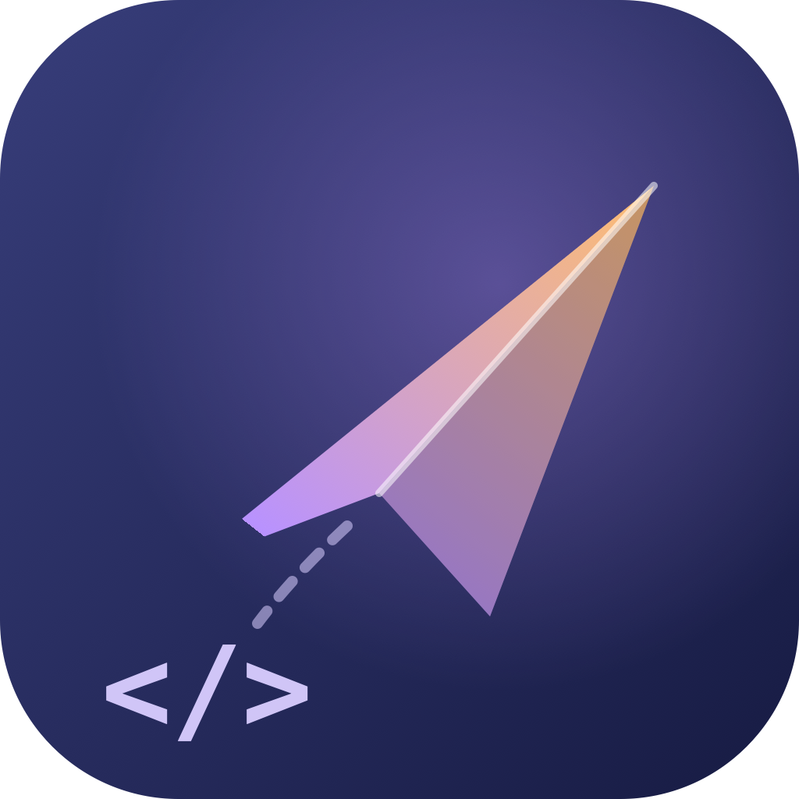
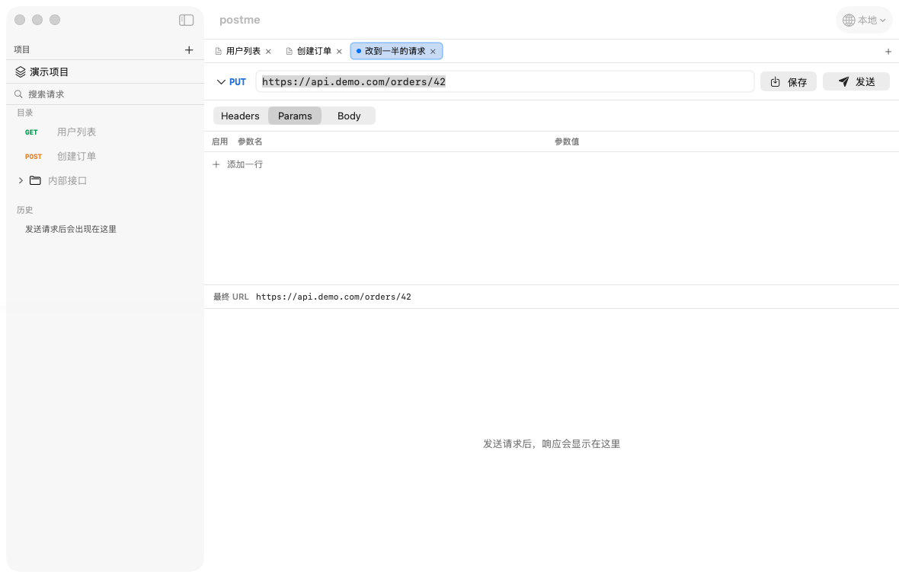

# postme

**简体中文** · [English](README.md)



一个**轻量原生 macOS 接口调试工具**，ApiPost / Postman 的替代品。

目标只有一个：把那部分常驻内存还回来。



---

## 为什么会有这个项目

ApiPost 日常常开，内存占用偏高。尝试过 Tauri，但它和 Electron 一样要在 macOS 内嵌
WKWebView——光 WebKit 的内容进程就是几十到一百多 MB，省不掉。

所以这里**不用任何 WebView**：原生 SwiftUI 画界面，`URLSession` 发请求。
代价是只能跑在 macOS 上，换来的是数量级的内存差异。

### 内存实测

| | postme | ApiPost |
|---|---|---|
| 物理内存（phys_footprint） | **约 40 MB** | 288 MB（峰值 424 MB） |
| 进程数 | 1 | 5（RSS 合计 261 MB+） |
| 安装体积 | 2.1 MB | — |

> 测量口径说明：这里用的是 macOS 活动监视器显示的 **phys_footprint**，不是 `ps` 的 RSS。
> postme 的 RSS 约 116 MB，但其中大部分是与系统框架共享的页——RSS 会把共享库重复计入每个进程，
> 用来比较同类应用会严重失真。phys_footprint 才是真实占用。

---

## 功能

### 请求调试
- 方法：GET / POST / PUT / PATCH / DELETE / HEAD / OPTIONS
- Headers、Query 参数（可逐行启用/禁用）
- **RESTful 路径变量**：URL 里的 `{id}` / `:id` 自动出现在 Params 的「路径参数」区；
  值支持 `{{变量}}`，发送前按单个路径段编码
- **认证页签**：Bearer Token / Basic Auth / API Key（可放 Header 或 Query）；字段支持 `{{变量}}`，
  发送前自动注入，已有同名 Header / 参数时不覆盖；导出 Postman 时保留认证结构
- **Cookie 分页**：手动 Cookie 行 + 会话内 Cookie Jar（默认关闭）；开启后记录响应的 `Set-Cookie`，
  按域 / 路径 / Secure / 过期时间回带，退出应用即清空
- 请求体：JSON、Raw Text、Form URL Encoded、Multipart Form（文本 + 文件字段）、
  Binary File（本地文件原样发送）、无
- **文件上传**：Multipart 文件字段与 Binary Body；单文件上限 64 MB，发送前校验路径与可读性；
  cURL / Postman 导入导出保留文件路径
- 响应：状态码、响应头、正文（JSON 自动美化 + 只读语法高亮，可切换格式化（树形）/ 压缩）
- **响应查找**（`⌥ ⌘ F` 或正文工具栏放大镜）：使用系统查找条，带匹配数、上一个 / 下一个
- **响应示例**：把当前响应存成示例（正文上限 2 MB），按请求查看 / 复制 / 删除；
  存在 `examples.json`，只在显式保存时写盘
- **JSON 树形视图**：格式化分页就是树形，按层级折叠 / 展开，单节点切换、一键展开或收起全部；键顺序与响应原文一致
- **请求体 JSON 语法高亮**：键 / 字符串 / 数字 / 字面量分色，编辑时防抖着色不拖慢输入
- **可取消**：请求进行中可随时中断（按钮或 `⌘.`），取消不算失败、不记历史
- **响应体有驻留上限**（16 MB）：超大响应不会把内存吃满，超限时明确标注已截断
- **分阶段耗时**：DNS 解析 / TCP 连接 / TLS 握手 / 等待首字节(TTFB) / 内容下载
- 请求历史（自动记录，可恢复到编辑器）：固定在侧栏**左下角**，默认收起，点标题栏展开；
  展开状态记在设置里，清空需要二次确认
- **复制为 cURL**（`⌥ ⌘ C`；请求栏的图标按钮与侧栏右键菜单同一功能）：把请求复制成一条命令行，
  变量按当前环境替换。命令与发送路径共用地址拼装与正文编码，粘到终端执行的就是 App 会发的那一发，
  连「跟不跟重定向 / 校不校验证书」都按 App 当下的设置写进 `-L` / `-k`
- **多页签编辑**：页签条的 `＋` 菜单可新建请求、或导入 cURL 命令，各占一格。
  每个打开的请求各有独立页签，草稿、未保存标记、请求/响应分页选择与响应都各自独立；
  打开别的请求不会覆盖正在输入的内容，因此不再需要「保存 / 放弃 / 取消」那一问。
  关闭有未保存修改的页签会先询问（保存并关闭 / 放弃修改 / 取消）。
  页签右键菜单提供克隆、关闭、关闭其他、关闭全部；克隆会把当前草稿（含未保存的修改）原样复制成紧挨着的新一格，
  副本不归属原请求，保存时新建一条请求，不会覆盖原件；批量关闭遇到脏页签时合成一次确认（丢弃修改并关闭 / 取消），
  不会逐个弹窗。
  发送与取消都是**按页签**的：一个页签在慢请求进行中，切到另一个页签照样能发；
  点「取消」只中断当前页签。页签（含各自草稿、以及它归属的已保存请求）也会防抖落盘，异常退出不丢
- **SSE（`text/event-stream`）**：响应是事件流时（按 `Content-Type` 自动识别）**边收边显示**，
  不再等整条流结束。「事件」分页逐条列出序号、事件类型徽标、`id`、到达时间与数据（可单条复制），
  并按需自动滚动到底部；分帧按 SSE 规范（`data:` / `event:` / `id:` / 注释 / 多行 data，
  CRLF、LF、CR 三种行尾），随时可取消且已收事件保留，事件最多保留 2000 条
  （更早的丢弃并如实标注丢弃数）。非 SSE 响应行为不变。
  **超时是「空闲」超时**：只要服务端持续推数据，长流不会被总时长掐断；但服务端静默超过设置秒数仍会中断，
  需要时调大设置。不自动重连。
- **大模型输出（仅 SSE）**：在 SSE 响应里多出一页「大模型输出」，把某个字段的增量按到达顺序拼成
  一段连续文本——不再需要把几十条 `delta.content` 目视拼一遍。**主区域只拼接一个选定字段**，
  其余可拼接字段以折叠列表给出（字段名、字数、片数，展开可看拼接结果）；字段选择跟随页签。
  内置三套路径：**OpenAI**（`choices[i].delta.{content, reasoning_content, reasoning, tool_calls[j].function.arguments}`）、
  **Anthropic**（`content_block[i].{text, thinking, partial_json}`）与
  **LangChain / LangGraph**（`response.blocks[i].{text, thinking, input}`、`response.content`），
  也可**自定义路径**（只支持 `键` 与 `[下标]`，如 `choices[0].delta.custom`；
  在页签内或设置页里添删，最多 16 条）。LangChain 每步推的是**整份快照**而非增量，
  所以该套规则在「新值以旧值开头」时替换、完全重复时忽略——同一份答案不会被拼两遍。
  单字段最多拼 512 KB（到顶标注并停止），最多 64 个字段（被上限丢弃的数量如实标注）。
  事件、Body 等其它分页与默认落点都不变——SSE 结束后仍停在「事件」。

### 项目管理（参考 ApiPost 的「项目」层级）
- 侧栏顶部**项目切换器**：一次聚焦一个项目，目录树只显示当前项目
- 项目新建 / 重命名 / 删除都在**项目切换菜单**里，侧栏 `＋` 只管当前项目内的一件事：**新建文件夹**。
  **新建请求**与**导入 cURL** 挪到了编辑器页签条的 `＋` 菜单——这两件事产出的是新页签，
  不是「当前项目里的某个东西」；
  删除含全部目录和请求，不可恢复，至少保留一个项目
- 项目内分组树（文件夹可嵌套）、重命名、删除；顶层文件夹可一键「提为项目」
- **拖拽整理**：拖动请求 / 文件夹可在同级排序；拖到文件夹中间移入该文件夹；
  文件夹不能拖进自己的子树
- **保存**：**当前页签**已归属某个已保存请求时，`⌘ S` 原地覆盖（归属随页签一起落盘，
  重启后仍是覆盖而不是新建）；未归属时弹窗命名，目标项目默认当前项目，可切换项目与文件夹
- 按名称/URL 搜索（范围是当前项目）
- **OpenAPI / Swagger 导入**（`⌘ ⇧ O`）：支持 **Swagger 2.0 与 OpenAPI 3.x 的 JSON 文件**；
  tags → 文件夹，path / query / header / cookie 参数、JSON / form / multipart 请求体、
  bearer / basic / apiKey 认证与 servers / host → `baseUrl` 环境；导入前有预览与提示。
  只读本地文件，不做响应文档、Mock 或双向同步
- **Postman Collection v2.1 导入导出**（ApiPost、Postman、Insomnia 都能导出这个格式）
- 导入时每个集合成为一个**同名项目**并激活；导出的是**当前项目**
- 侧栏顶部「**导入**」菜单集中提供 OpenAPI / Postman / cURL 导入与当前项目导出；
  系统菜单栏保留相同动作和快捷键
- 导入时保留认证：bearer / basic / apikey 会物化为等效 header 或 query 参数；
  无法静态还原的认证类型（oauth2 等）会在导入结果里明确提示
- **cURL 导入**（`⌘ ⇧ V`）：粘贴浏览器 / Postman 的 Copy as cURL 或终端命令，
  默认**并入当前项目**（要新建项目也就一次点击）；多条命令、`--next` 分段会各自成为一个请求，
  并且导入后自动打开第一个导入的请求，下一步就是发它
- 旧版 workspace.json 自动迁移：原顶层集合整体收进一个「默认项目」，节点原样保留

### 环境变量
- 多环境切换，`{{变量名}}` 替换作用于 URL / Headers / 参数 / 请求体
- 内置动态变量（无需定义）：

  | 变量 | 值 |
  |---|---|
  | `{{$timestamp}}` | 当前 Unix 秒 |
  | `{{$isoTimestamp}}` | ISO8601 时间 |
  | `{{$uuid}}` | UUID |
  | `{{$randomInt}}` | 随机整数 |

> 未定义的变量会**原样保留**并在界面上提示，不会被静默替换为空。

### 界面语言
- 设置里可切换 **跟随系统 / 简体中文 / English**，切换立即生效并持久化
- 界面文案、菜单、弹窗、导入提示与错误信息全部跟随所选语言

### 路线图
与 ApiPost 的功能差距、优先级排序与后续计划见 [docs/ROADMAP.md](docs/ROADMAP.md)。

### 明确不做
登录 / 账号 / 云同步、请求前后脚本与断言、团队协作。

---

## 构建与运行

### 环境要求
- macOS 14.0 或更高
- Xcode 或 Swift 工具链（开发时使用 Swift 6.3 / Xcode 26 验证）

### 命令

```bash
make app     # 编译并打包成 build/postme.app（含 ad-hoc 签名）
make open    # 打包后用 LaunchServices 打开（菜单栏/聚焦最正常）
make run     # 开发期直接运行（debug，靠 AppDelegate 兜底激活）
make build   # 只编译，不打包
make cli     # 编译并生成 build/postme 命令行入口
make clean   # 清理构建产物
```

首次构建后，把 `build/postme.app` 拖进「应用程序」文件夹即可日常使用。

### 命令行界面（CLI）

同一个可执行文件包含两种模式：不带参数启动 GUI，带子命令进入无窗口 CLI。`make cli` 会生成
方便的 `build/postme` 入口；打包后的应用也可通过 `build/postme.app/Contents/MacOS/postme` 调用。

```bash
build/postme --help
build/postme project create "我的项目"
build/postme import openapi ./openapi.json --new-project "Demo API"
build/postme import postman ./collection.json       # 始终创建新项目
build/postme import curl ./request.curl --project "Demo API"
cat ./request.curl | build/postme import curl - --new-project "从标准输入导入"

build/postme --json project list
build/postme --json request list --project "Demo API"
build/postme request show <请求 UUID>
build/postme environment create Development
build/postme environment set Development baseUrl https://localhost:8080
build/postme export postman "Demo API" --output ./collection.json
build/postme folder create "Users" --project "Demo API"
build/postme --json folder list --project "Demo API"
build/postme folder rename <文件夹 UUID> "Accounts"
build/postme --json request show <请求 UUID> > ./spec.json
build/postme request create ./spec.json --name "Ping v2" --project "Demo API" --folder <文件夹 UUID>
build/postme request update <请求 UUID> ./spec.json --folder root
build/postme request delete <请求 UUID> --yes
build/postme folder delete <文件夹 UUID> --yes
```

- OpenAPI 默认创建新项目，`--project` 则以文件夹形式并入已有项目；cURL 默认导入当前项目根目录；
  Postman 与 GUI 行为一致，始终创建新项目。
- 项目与环境可用准确名称或 UUID 定位；名称重复时必须用 UUID。请求命令使用 `request list`
  输出的集合节点 UUID。
- `--json` 输出稳定、机器可读的 JSON。导出命令未指定 `--output` 或指定 `-` 时，直接把 Postman
  JSON 写到标准输出。
- `--data-dir <目录>`（或 `POSTME_DATA_DIR`）可覆盖默认数据目录，便于隔离任务和测试。所有写操作
  同步落盘。退出码：`0` 成功、`1` 操作失败、`2` 参数错误、`3` 工作区并发冲突；`--json` 模式下错误
  还会带稳定的 `code`（`workspace_busy` / `workspace_conflict`）以及 `exitCode`。删除数据或清空历史
  必须显式传 `--yes`。`POSTME_DATA_DIR` 对 GUI 同样生效（GUI 的 Foundation 不跟随 `HOME` 覆盖）。
- `request create <文件|->` 与 `request update <请求 UUID> <文件|->` 从文件或标准输入读一份完整的
  `APIRequest` JSON；也接受 `request show --json` 的完整输出（取其 `request` 对象与顶层 `name`），
  因此 `show` → 改 → `update` 可以直接闭环。名称优先级：`--name` > JSON 的 `name` > 请求自带名；
  `update` 不给名称时保留原名。节点 UUID 与请求 UUID 都保持不变，已打开的页签归属不失效。
  缺少 `url` / `method` / `headers` / `bodyKind` 的输入会以退出码 2 拒绝，不会静默写出一条空请求。
  `create` 未指定 `--project` 时落在当前活动项目。
- `folder list|create|rename|delete` 管理集合树：`folder list --json` 给出每个文件夹的 UUID、
  层级 `path` 与 `requestCount`；`folder create --in <文件夹 UUID>` 建子文件夹。
  `request create --folder <文件夹 UUID>` 把新请求放进该文件夹，`request update --folder` 把已有
  请求移过去，`--folder root`（或 `-`）移回项目根；不带 `--folder` 时 create 落项目根、update 保持
  原位置。目标文件夹不存在会直接报错，不会像 GUI 那样兜底建到根目录。
  `folder delete` 连同整个子树一起删，必须 `--yes`。
- 项目、文件夹、请求、环境和历史的完整子命令见 `build/postme --help`；环境还支持 `use`、
  `deactivate`、`unset` 和 `delete`。

> **并发写入会被拒绝，绝不静默合并。** GUI 与 CLI 只在写操作期间短暂持有排他锁，并在每次写入前
> 比对磁盘指纹（乐观 CAS）。写命令若发现目录正被占用或磁盘已被改动，会以退出码 3 失败且
> **不写入任何文件**——等另一个进程结束后重试即可。只读命令不受影响，但可能读到四个 JSON 文件
> 之间不完全一致的快照（单份文件仍是原子写入）。GUI 重新激活时会检测外部改动并重载；若存在
> 尚未落盘的编辑，会先询问是否放弃。

> **为什么不直接 `swift run` 日常用**：以裸二进制启动时进程是 accessory 姿态，窗口不会置前、
> 也没有应用菜单栏。代码里用 `NSApplicationDelegateAdaptor` 做了激活兜底，但正式使用还是
> 走 `.app` 更正常。

### Agent 技能

`skills/postme/SKILL.md` 随仓库分发，是给 AI agent 看的技能说明：写清 CLI 子命令、选择器、
`--json` 输出、退出码与并发写冲突规则，让 agent 不必猜参数就能操作工作区。
它只覆盖 CLI 用法——发送 HTTP 请求或修改 Postme 源码不在范围内。

把该目录链到 agent 的技能目录即可启用，例如：

```bash
ln -s "$PWD/skills/postme" ~/.codebuddy/skills/postme
```

若该路径下已有同名 `postme`，先移除或替换。技能里的命令名默认 `postme` 已在 `PATH` 上；
直接用构建产物时换成 `build/postme`（或 `build/postme.app/Contents/MacOS/postme`）。

### 零依赖

`Package.swift` 里没有任何 `dependencies`。所有功能都由 Foundation / SwiftUI / AppKit 实现。

---

## 使用要点

### 快捷键

| 操作 | 快捷键 |
|---|---|
| 发送请求 | `⌘ ↩` |
| 取消请求 | `⌘ .` |
| 保存请求 | `⌘ S` |
| 新建请求 | `⌘ N` |
| 搜索请求 | `⌘ F` |
| 在响应中查找 | `⌥ ⌘ F` |
| 导入 cURL | `⌘ ⇧ V` |
| 复制为 cURL | `⌥ ⌘ C` |
| 导入 OpenAPI / Swagger | `⌘ ⇧ O` |
| 导入 Postman / ApiPost 集合（新项目） | `⌘ ⇧ I` |
| 导出项目 | `⌘ ⇧ E` |
| 设置 | `⌘ ,` |

### 数据存储

状态按**变更频率**拆成四个 JSON 文件，放在同一个目录里：

```
~/Library/Application Support/postme/
├── workspace.json   项目（含目录树）、环境、设置
├── tabs.json        打开的页签（草稿 + 基线 + 归属）
├── history.json     发送历史（最多 200 条，含请求快照）
└── examples.json    响应示例（按请求归属，只在显式保存时写）
```

**为什么要拆**：编辑器里每敲一个键都会触发保存。单文件方案下每次保存都要把
200 条历史连同正文重新编码一遍——实测 50 MB 的工作区单次编码 132 ms、原子写 87 ms
（都在主线程上），文件一大打字就卡。拆开之后逐键编辑只重写 `tabs.json`（KB 级），
历史只在发送后写；没变化的文件直接跳过（按内容比对，不重写、不动修改时间）。

写入前有 600 ms 防抖，退出时会同步落盘。四个文件都是可读文本，可以直接用 git 备份或版本管理。

迁移与容错：

- v4 及更早的**单文件**（页签与历史都在 `workspace.json` 里）载入后照常使用，
  首次保存时自动拆成三份，核心文件里的 `tabs` / `history` 键随之消失；
- 顶层 `collections` 会整体迁移为「默认项目」，节点原样保留；没有页签概念之前的
  `draft` + `draftNodeID` 会迁移成**一个页签**；侧车存在时以侧车为准，旧键忽略；
- **解码是容错的**：缺字段、字段类型不符、未知枚举值都退回默认值，单个坏节点/坏页签只丢自己；
- 文件损坏时**只备份坏的那一个**（`workspace.json.corrupt-<时间戳>`，同名自动加序号），
  其余文件照常载入；若备份本身失败，原文件原地保留，绝不被空工作区覆盖。

### 调试内网服务

`Info.plist` 里开启了 `NSAppTransportSecurity → NSAllowsArbitraryLoads`。
**这是必需的**——否则调试 `http://localhost`、`http://192.168.x.x` 会被 ATS 拦截，
而且报错信息很难定位。

自签证书的 HTTPS 服务，在「设置 → 忽略 HTTPS 证书校验（自签证书）」里开启对应开关即可
（只影响 TLS 证书校验，默认关闭）。

---

## 设计说明

几个不那么显然、但踩过坑的决定：

**编码必须自己来，不能用 `URLComponents`。**
Foundation 序列化 query item 时**不会编码 `+`**。而按 form-urlencoded 规范，以及 PHP / Java Servlet /
Python `parse_qs` / Rails 等大量服务端的实际行为，query 与表单里的 `+` 会被解码成**空格**——
于是 `+8613800138000` 会静默变成「 8613800138000」。对一个接口调试工具来说，
静默篡改用户输入是不可接受的。所以 `FormEncoding` 自行编码，把 `+` 连同 `& = ? # %` 一起剔除出允许集。

**「最终 URL」预览必须真的等于最终 URL。**
预览曾和发送各写一套逻辑，结果两处都出现过分歧：先是编码不同（预览显示 `+`，服务端收到 `%2B`），
后是变量替换不同（预览把 `{{baseUrl}}` 编码成 `%7B%7BbaseUrl%7D%7D`，而实发的是替换后的地址）。
现在预览老老实实走完整流程：**先用 `AppState.resolveDraft` 做变量替换，再交给 `RequestExecutor.previewURL`
做 query 合并与编码**——与发送同一入口，从结构上不给分歧留空间。

**`URLSession` 会强引用它的 delegate。**
而 delegate 就是执行器自身，构成 `executor → session → executor` 的循环引用，
`deinit` 永远不会执行。切换设置重建执行器时必须显式 `invalidate()`，否则每次切换泄漏一个 session。

**文本控件必须关掉全部「智能替换」。**
macOS 默认的智能引号会把 JSON 里的半角 `"` 换成弯引号 `”`，静默损坏请求体且极难排查。
`CodeTextView` 里关闭了智能引号、破折号、文本替换、拼写纠正、连续拼写检查、语法检查、
链接检测、智能插入删除，共 8 项。

**打包脚本必须最后一步才 `codesign`。**
先签名、后修改 `Info.plist` 会使签名失效，App 启动时被系统直接 SIGKILL。

**大响应要防主线程卡死。**
超过 2 MB 的响应体截断展示，超过 1 MB 不做语法高亮（请求体同理）；文本控件用缓存的已写入值判断是否需要
更新，而不是访问 `textView.string`（那个访问器每次都会把整个文本存储物化成新字符串）。

**「省内存」不能只做展示层。**
展示层的截断阈值只管显示文本，管不住内存——实测一个 120 MB 的响应会让进程占用从 2 MB 涨到
147 MB，正好把本项目的立身之本的差距抹平。所以传输层另设 16 MB 硬上限：超出即停止累积、
取消该 task，并把"数据本身没收全"这个事实（`isBodyTruncated`）透出到界面。
半截 JSON 不再尝试美化——美化必然失败，回退原文又会让人以为这就是全部响应。

**截断和用户取消底层是同一个错误码。**
两者最终都是 `NSURLErrorCancelled`，必须用显式标记区分：截断要返回**部分响应**并如实标注，
用户取消要静默回到空闲、不报错也不记历史。只靠 `URLError` 判断必然把其中一种做错。

**工作区解码必须容错，但容错要有底线。**
原先用编译器合成的解码，任何非可选键缺失都会让整份 `workspace.json` 解码失败，
随后被搬成 `.corrupt-*` 并以空工作区启动——集合、环境、历史一次性全没，
而**加一个字段就能触发**这条路径。现在所有持久化模型都显式容错解码。
但底线不能丢：文件必须是 JSON 对象且含至少一个能识别工作区的字段（`version` 不算，
单独一个 `{"version":7}` 不该被认领），否则仍判损坏走备份——把不相干的文件静默当成
空工作区、再被下次保存覆盖，比报错更糟。

**会顶掉用户内容的选择题，修法不是把提示做对，而是让冲突不存在。**
最早只有一块编辑缓冲，打开另一个请求就只能问「保存 / 放弃 / 取消」。那套状态机本身有个
隐蔽缺陷：提示要先把侧栏选中项回滚到当前编辑节点，可这个回滚会**再触发一次** `onChange`，
于是同一套逻辑被调用第二次，把用户真正点击的目标覆盖成「回滚后的节点」——用户选完
「保存并继续」后停在原地。当时的修法是「已有挂起动作时拒绝新动作」，治的是症状；
**页签把病根去掉了**：每个打开的请求各有草稿，没有东西需要丢弃，也就没有提示可以出错。
但那条教训留下了：侧栏选中变化的入口仍然收在 `AppState.handleSidebarSelection`，
让选中链路能被测试直接驱动；关闭确认拆成「弹窗被关掉」（纯表现）与「取消」（丢掉待关闭目标）
两个回调——把这两者合并成一个回调会把「保存并关闭」静默弄坏，现在有测试钉住。

**按页签并发就必须按页签取消，结果也要按身份回写。**
多个请求同时在飞时，「取消」不能再等于「全取消」——用户看的是某一个页签，
掐掉别的页签的请求会丢掉他根本看不见的工作。所以执行器给每个任务打上发起页签的标记
（`send(_:token:)` / `cancel(token:)`）。回写同理：`send()` 在 await **之前**先捕获页签 id，
拿到响应后按 id 回写，页签已经关掉就丢弃——写成「写到当前页签」会把响应显示在一个
根本没发出该请求的请求旁边，这是调试工具能犯的最误导人的错误。

**Postman 导入不能 all-or-nothing，也不能静默丢认证。**
`auth` 是 v2.1 的一等字段，忽略它会让带 Bearer 的集合导入后所有请求 401——用户会以为工具坏了。
能静态表达的类型（bearer / basic / apikey）物化成等效 header 或 query 参数；
需要动态签名的类型（oauth2 等）明确列进导入结果，而不是假装没有。
解码同理：`request` 可以是字符串、`header` 可以是原始字符串块（schema 都允许），
单个畸形条目应该只影响自己，不该让整份文件被拒。

**cURL 导入的目标是「服务端收到的字节与 curl 一致」，不是「字段长得像」。**
命令是照抄来的，用户看不见 postme 把它理解成了什么，所以判断标准只能是发出去的东西。
据此有几处反直觉的选择：`-d` 哪怕内容是裸 JSON 也保留 curl 的
`Content-Type: application/x-www-form-urlencoded`（改成 `application/json` 会让服务端换个解析器）；
`--data-urlencode` 的值按**字面文本**处理，不先 percent-decode（curl 连 `%` 一起编码，
先解码会少一层转义）；`-G` 下 `-d` 与 `--data-urlencode` 都进 query。
无法随请求带走的全局选项（`-k` / `-L` / `-m` / `-x`）一律进提示列表——
静默忽略会让用户以为导入完整，发出去才发现不对。

**导出成 cURL 用的是同一条判据的反面：命令必须能发出 App 发出的东西。**
命令与发送路径共用地址拼装（`previewURL`）和同一张「隐含 Content-Type」表，
只导出启用且键非空的行；测试钉住 `CurlCodec.decode(CurlExport.command(for: r))` 的往返。
四个 flag 是**刻意**选的，各有测试兜底：

- `--data-raw` 而不是 `-d`：curl 的 `-d '@文件'` 会去读文件，正文以 `@` 开头时粘出去就变了。
- `--form-string` 而不是 `-F`：`-F` 把取值里的 `@` / `<` / `;` 当语法，
  `note=a;b=x` 会变成 `a`。
- 只有 GET **真的带正文**时才写 `-X GET`：不然 curl 会自行改成 POST；
  HEAD 不带正文用 `-I`（`-X HEAD` 会让 curl 等一个 HEAD 本就没有的正文）。
- multipart 不写死 `Content-Type`：boundary 必须由 curl 自己生成，否则头与正文对不上。

含控制字符的取值用 ANSI-C 引用 `$'...'`——经基于 JSON 的剪贴板中转不易被压平；
`-L` / `-k` 只在 App 设置开着时才写，所以命令描述的是「App 这一次的实际行为」而不是理想化的样例。

---

## 项目结构

```
Sources/Postme/
├── PostmeApp.swift          进程入口（GUI / CLI 分发）+ AppDelegate + 菜单命令 + Settings
├── AppState.swift           顶层状态容器（@MainActor @Observable）+ 页签状态机
├── CLI/                     无窗口命令解析 + 同步工作区导入与数据操作
├── Models/                  纯数据：请求、响应、项目、集合树、环境、历史、工作区
│   ├── EditorTab            一个打开的页签：草稿、基线、归属节点、页签级运行态
│   ├── Project              项目层（顶层容器，旧版 collections 的迁移目标）
│   └── TolerantDecoding     持久化模型的容错解码辅助
├── Services/                纯逻辑，只依赖 Foundation
│   ├── RequestExecutor      URLSession 执行 + TaskMetrics 耗时 + 自签证书 + 响应体上限 + 取消
│   ├── FormEncoding         query / form 组件百分号编码
│   ├── VariableResolver     {{var}} 替换
│   ├── PostmanCodec         Postman v2.1 导入导出（含认证物化与容错解码）
│   ├── CurlCodec            cURL 命令解析（引号 / 续行 / 多命令 / --next 分段）
│   ├── CurlExport           请求 → curl 命令（与发送路径同一套地址/正文拼装）
│   ├── Localization         语言模型与两张字符串表
│   ├── JSONTree             保序 JSON 解析 + 树形行模型（树形视图用）
│   └── PersistenceService   三文件读写（核心/页签/历史）+ 分节比对 + 防抖 + 同步落盘 + 损坏备份
├── Views/                   SwiftUI 界面
└── Components/              可复用控件（代码文本视图、键值表、JSON 高亮）

Tests/PostmeTests/           测试套件（含真实 socket 的响应上限/取消用例）
skills/postme/SKILL.md       agent 技能：给 AI agent 看的 CLI 用法（不参与应用构建）
```

`Models/` 与 `Services/` 刻意**不 import SwiftUI**。这让整个逻辑层可以脱离界面单独编译，
既能用 `swift test` 常驻回归，也能用临时 CLI 直接跑验证。

**测试为什么要进仓库**：v1 的验证断言全写在 `/tmp` 的临时程序里，不在版本库——
这意味着任何改动都没有回归护栏，重构一次就可能悄悄退掉已修好的行为。
现在它们是 `Tests/PostmeTests/` 的一部分，`swift test` 即可跑。

---

## 已知限制

- **cURL 导出的认证写成 header，而不是 `-u` / `--oauth2-bearer`**：App 存的是「发什么」而不是
  「怎么配的」，命令里就是物化后的 `Authorization`（或 apikey query 参数）——线上字节一致，
  但放在 header 里的密钥会出现在命令行与 shell 历史里。multipart 的文件字段是禁用占位行，不导出；
  `-L` / `-k` 只在 App 设置开着时才出现（没开「跟随重定向」时复制的命令也不会跟随）。
- **粘出去的命令与 App 在「谁都没声明的传输默认值」上不一样**：对照时逐项比的是声明过的头，
  它们一致；但 curl 发 `Accept: */*` 且不发 `Accept-Language`，URLSession 会带上系统语言的
  `Accept-Language`（`Accept-Encoding` 也可能不同）。做内容协商的服务端对同一条请求可能给出不同响应。
  这些值在请求模型里无从表达，命令也带不了。
- **App 自身发不出「GET + 正文」**：URLSession 直接以 -1103 拒绝，而导出的
  `-X GET --data-raw ...` 在真实 curl 下能发出去。这是发送层的限制，不是导出器偏离了发送路径
  （对照程序有记录）。
- **历史记录保存未替换的模板**（保留 `{{var}}`），好处是不落盘明文密钥，代价是历史里看到的是模板而非实际值。
- **OpenAPI / Swagger 导入只支持 JSON、文档内 `$ref`**：YAML、外部 `$ref`、响应文档、
  OpenAPI 导出、Mock 与双向同步都不做。
- **路径参数值按单个路径段编码**：值里的 `/` 会变成 `%2F`，需要多段路径时请直接改 URL。
- **JSON 美化基于 `JSONSerialization`，不保留键顺序**；格式化分页的树形用自带的保序解析器
  直接解析原始响应（2 MB 内），因此按原文顺序展示；「复制」仍输出美化后的文本。
- **树形在响应被截断、超过 2 MB 展示上限或节点数超过 20 万时不可用**（会提示并回落到文本）。
- **`⌘F` 绑定给侧栏搜索**，`⌥⌘F` 用于在响应中查找。
- **URL 栏里手输的 query 与参数表同时存在时，导出再导入会以参数表为准**。
  发送路径不受影响（两者会正确合并）。
- **响应体驻留上限 16 MB**：超过即停止接收、标记截断（省带宽与时间），
  不会把整个响应读进内存。小于上限的响应不受影响。
- **Postman 导入的认证只做静态物化**：bearer / basic / apikey 会转成等效的
  header 或 query 参数；oauth1 / oauth2 / digest / awsv4 / hawk / ntlm / edgegrid
  需要动态签名，无法在导入时还原，会在导入结果里明确列出而不是静默丢弃。
- **暂不支持在项目间移动目录**：v1 只提供顶层文件夹单向「提为项目」。
- **Postman 导入固定为新项目**（不能并入当前项目）；cURL 导入两种都可以。
- **cURL 导入只覆盖能静态还原的语义**：全局选项（`-k` / `-L` / `-m` / `-x` / 客户端证书）、
  `-F key=@file` 文件字段、`@file` 读正文无法随请求带走，都会在导入结果里明确提示而不是静默丢弃。
  `--data-urlencode` 的 `name@file` / `@file` 形态同理。
- **cURL 导入把 query 建模为键值对**：空格编码成 `%20`（curl 用 `+`），hex 大小写也不同；
  `application/x-www-form-urlencoded` 解码后与 curl 等价，但按**原始 query 串**做签名校验的
  服务可能不等价。另外 URL 里的字面 `+`（`?q=a+b`）会按表单约定解码成空格，
  与 RFC 3986 的严格解析不同——这是「query 建模为键值对」的结构性取舍。
- **环境变量是全局的**，不跟随项目切换（项目层的环境隔离未做）。

## 验证状态

- `swift test`：**全部通过**（`Tests/PostmeTests/`）
  - 覆盖变量替换、Postman 编解码与往返、集合树、持久化落盘、URL 与请求体组装、
    预览与实发一致性、workspace schema 容错与旧文件迁移、项目层级状态机、
    响应体上限与取消、Postman 认证与容错导入、页签编辑（各页签草稿与脏状态、关闭确认、
    保存指向当前页签、页签持久化与 v3→v4 迁移）、cURL 解析 / 导入落盘 / 导出往返
    （含保证命令与实发一致的几个 flag）、
    以及本地化完整性
  - 响应体上限与取消走**真实 socket**（`LocalHTTPServer`），不是 mock
  - `JSONHighlighterTests` 覆盖高亮契约：键/值/数字/字面量分色、转义引号不提前结束字符串、
    **着色不改动正文任何一个字节**、编辑态可着色、超上限跳过着色、编辑态防抖与取消、
    JSON ↔ Raw Text 开关翻转（经真实 SwiftUI 宿主，见下）
- 高亮的编辑态开销经**实测标定**（临时程序，不进仓库）：着色为 O(n) 属性扫描，
  200 KB ≈ 10 ms；故编辑态走 150 ms 防抖，只读响应体一次性着色。
  另实测确认：属性写入不进撤销栈、不触发 `textDidChange`、输入字符不继承颜色，
  因此编辑态着色不会干扰输入与 ⌘Z。
  高亮开关翻转有一条**只在宿主视图里才能复现**的回归（切到 Raw Text 残留配色），
  故该用例经 `NSHostingView` 驱动，而非直调 coordinator——直调版本删掉修复照样通过
- cURL 解析器与**真实 `curl` 逐字节对照**：18 条典型命令（浏览器 Copy as cURL、Windows/PowerShell
  续行、`-G`、`-G -F`、multipart、`-u` / `-b` / `--oauth2-bearer`、ANSI-C 引号、`--next`、
  裸 JSON `-d`）在本地回显服务上同时用 curl 与 postme 发送，比较方法 / 路径 / 正文 / 头。
  语义项全部一致；仅剩三处**有意为之**的表示差异（服务端解码后等价）：
  空格编码 `%20` vs `+`、hex 大小写、multipart boundary 取值。
  该对照脚本是临时程序（不进仓库），仓库内由 `CurlCodecTests` 固化同样的断言
- **导出器同样与真实 `curl` 对照过**（临时对照程序，用完已删）：8 条请求——带空格 / `+` / 中文的
  query、含换行 / 引号 / `$` / 反引号的 JSON 正文、含 `&` 与 `+` 的表单、
  取值里带 `;` 与 `@` 的 multipart、带 JSON 正文的 DELETE、以 `@` 开头的纯文本正文、空 JSON 正文——
  **把生成的命令交给真实 curl 执行**、与 postme 自己的发送路径打到本地回显服务上，
  比较方法 / 路径 / 头 / 正文。比对项全部一致；唯一差异是 multipart 的 boundary
  （两边各自生成，part 本身一致）。另有一条**刻意保留的不一致**并已写进已知限制：
  App 发不出「GET + 正文」（URLSession 报 `-1103`），而 curl 能发。
- **剪贴板路径**（临时程序，用完已删）：`FileActions.copyAsCurl` 直打真实 `NSPasteboard`，
  剪贴板里就是该请求的 `curlCommand(for:)`，再把它喂回 `CurlCodec` 能还原出
  方法 / URL / 头 / JSON 正文。本特性的负向对照：把 `--data-raw` 换回 `-d`、
  去掉隐含 `Content-Type`、把 `--form-string` 换回 `-F`、去掉导入面板的自动打开，
  各自都能让对应测试失败。
- **真实 App 的导出入口**：用预置工作区（三个页签、其中一格有未保存修改）启动 release 包，
  抓窗口像素 + Vision OCR，确认请求栏上「复制为 cURL」**只渲染图标**、文字不再占用栏宽
  （说明文字在 tooltip 与无障碍标签里）；把 `Image` 改回 `Label` 会让该用例失败。
- `swift build -c release` 零警告零错误
- CLI：5 项 `CLIWorkspaceTests` 覆盖导入/环境持久化、带脏草稿的项目激活（含真实 `AppState` 启动）、
  请求删除与最后一个项目保护，以及 create/update 落盘往返（UUID 保持、不传名称时保留原名）；
  2 项 `CLIExitCodeTests` 用真实 JSON 文件经 `PostmeCLI.run` 跑通 create/update，并断言不完整输入
  被拒绝且不写入。另在隔离目录完成三种格式导入、请求/项目/环境/历史操作、Postman 导出、删除确认
  和退出码的端到端验证。全量 `swift test` 在装有 Xcode 的 macOS 环境共执行 **437 项测试**
  （7 项跳过、0 失败），含本次新增的 4 项；只装 Command Line Tools 的环境缺 XCTest，跑不了全量。
  create/update 本身还用编译出的二进制在隔离数据目录实测：`show` → 改 → `update`、两种 JSON 形态、
  UUID 保持与负控（退出码 2、不写入）。
- 本地化：`LocalizationTests` 断言两张字符串表覆盖全部键、
  两语言间的格式占位符一致（含 `%.1f`）、英文表不含任何 CJK 字符、语言变化可被观察
  （菜单栏重算依赖的机制）、选择能往返落盘、缓存中的响应展示文本会重算，
  以及「未命名」占位名在**两种语言下**都能被识别——最后这条对应的失效模式是
  「只改了字面量、没改判定」，它能编译、能过粗糙的 grep，却会把历史记录命名错。
  对 `Views/`、`AppState`、`PostmeApp` 里用户可见中文字面量的扫描结果为零；
  剩下的中文是持久化模型的容错解码默认值、旧版迁移项目名，以及语言自身的显示名。
- 真实 App 进程实跑：缺字段的旧版 `workspace.json` 正常载入且数据完整、不产生 `.corrupt-*`；
  无关 JSON 仍被判损坏并备份
- **页签栏在真实运行进程上验证过**：用预置的 v4 工作区（三个页签——两个绑定已保存请求、
  一个有未保存修改）启动 release 包，`screencapture -l <窗口号>` 抓窗口像素，再用 Vision OCR
  读回文字。OCR 结果里能看到三个页签标题各自带关闭图标、第三个页签上的未保存标记，
  以及编辑器里属于第三个页签的内容（`PUT https://api.demo.com/orders/42`）——
  即从磁盘恢复、脏标记与激活页签的接线都与设计一致。点击仍未验证（见下）。
- **菜单内容在进程内读出**（临时探针，用完已删）：把 `EditorTabBar`、`SidebarView` 放进真实窗口
  并弹出 `＋` 菜单，打印 NSMenu 的菜单项标题——页签条是 `["新建请求", "导入 cURL 命令…"]`；
  侧栏 `＋` 则是一个**没有菜单**的普通按钮（点它直接弹出新建文件夹弹窗，`window.attachedSheet`），
  项目切换器保留自己的项目菜单。SwiftUI 的菜单项是弹出那一刻才构建的，所以这次读取必须真的弹出。
- **编辑键值行（Params / Headers / 表单字段）后再切页签会把 App 打崩**——`Fatal error: Index out
  of range`，栈为 `PlatformTextFieldCoordinator.controlTextDidEndEditing` → `Binding.subscript.getter`
  → `Array._checkSubscript`，即无弹窗直接 SIGTRAP。根因：行是用 `ForEach($items)` 绑的，
  它的元素绑定**按下标**；当编辑器绑定的数组被换掉（另一格）或变短后，
  结束编辑的写回仍打到那个旧下标上（新数组更短）→ 越界。现在逐行**按 id** 绑定
  （`KeyValueEditor.binding(for:)`）：行已经不在数组里就退化成 no-op——不崩，
  也不会把 A 格的行写进 B 格。由 `KeyValueEditingSafetyTests`（4 条）钉住：真实窗口 + 真实 AppKit
  焦点 + 走真实字段编辑器改 `$app.draft.queryParams`，其中一条还挂载整个 `ContentView`；
  负向对照（换回下标绑定）能复现同一个 SIGTRAP。同类绑定在 `EnvironmentEditor`
  里早已避开（`bindingForEnvironment(id:)`）；全仓扫描后已无 `ForEach($…)` 或下标式绑定。
- 独立交付审查（第 1 轮 REJECT → 返工 → 第 2 轮 REJECT → 返工 → 第 3 轮 PASS）；
  第 2 轮阻断项为「`-d` 裸 JSON 被改成 `application/json`」（违反字节一致判据，已改为保留
  curl 隐含的表单类型并补回归测试）与「`-G -F` 生成 GET + multipart 正文」（curl 实际忽略
  `-G`，已对齐并补测试）；第 3 轮另指出「`-d ''` 空正文丢失 Content-Type」（已按同一判据修好）。
  三处修复均附负向对照（回退修复 → 对应测试必失败）
- **未验证**：图形界面里的任何点击（本机辅助功能读取被系统阻塞，无法自动化点击，
  合成鼠标事件同样被丢弃；本次验证期间屏幕处于锁定状态，锁屏会全系统阻断 AX 读取）；页签栏、关闭确认弹窗等点击路径由状态机测试
  加上上面那条「运行进程 OCR 验证」间接覆盖，但没有一个按钮被人工按过。
  v3 新增的项目切换器、提为项目、
  导入导出文案同样只经过逻辑层测试，未经人工点击验证。
  cURL 导入面板同理：`CurlCodec` 与 `AppState.importCurlRequests` 有测试覆盖，
  但**面板本身的点击路径（菜单项 → 剪贴板预填 → 预览 → 导入 → 提示）未经人工点击验证**。
  它的「导入到」选择器同样只由常量级测试加状态层导入测试钉住，
  没有从屏幕像素上读出选中项（分段选择器的「选中态」对 OCR 不可见）。
  复制为 cURL 除按钮按压之外都有覆盖：状态层产出命令、生成的命令在对照程序里被真实 curl 执行过、
  剪贴板写入也直打过一次真实 `NSPasteboard`——但没有任何按钮被人工按过。
  语言切换则两层都有：字符串表完整性、持久化与即时重算的单元测试，加上
  `GUILanguageRenderTests`——它把真实的设置面板 / 请求编辑区 / 侧栏放进真实窗口渲染，
  抓取窗口像素并用 Vision OCR 读回文字，断言在**同一个** `AppState` 实例上
  zh → en → zh 切换时可见文案随之变化（即界面真的重画了，而不只是字符串表正确）。
  该用例需要屏幕录制权限，因此默认跳过，显式运行：
  `POSTME_GUI_VERIFY=1 swift test --filter GUILanguageRenderTests`。
  语言 Picker 本身仍未人工点击验证。

---

## 许可

[MIT](LICENSE) © 2026 caozeal
