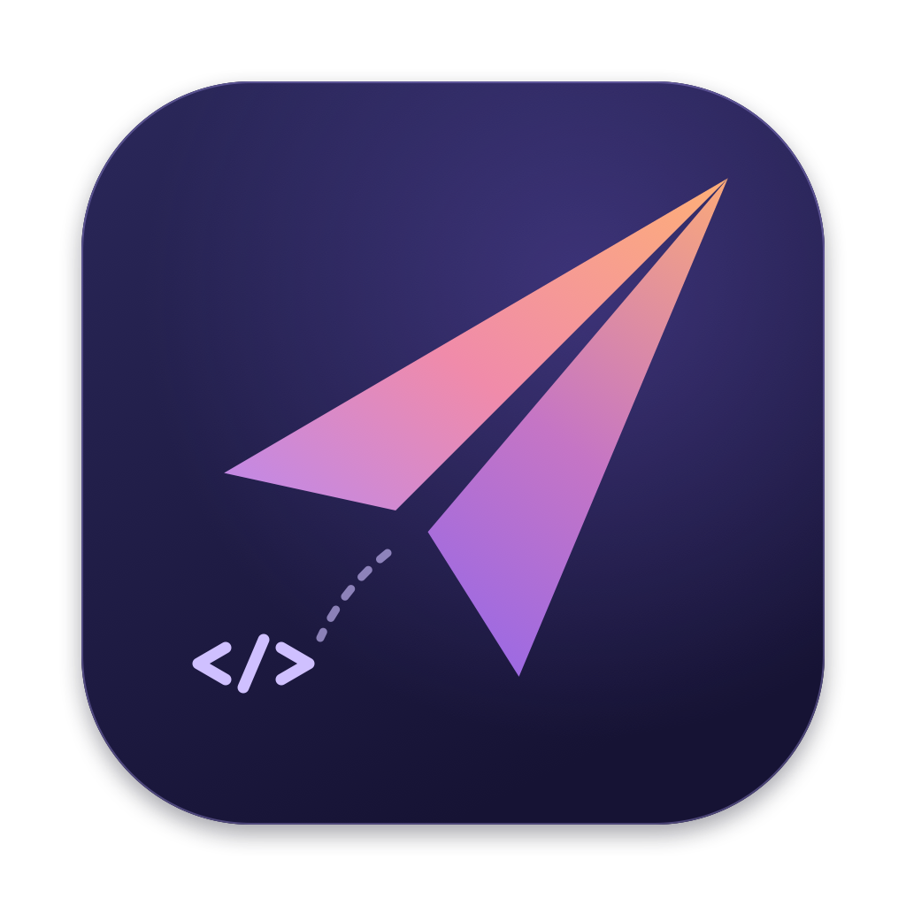

# Postme 图标设计规范

Postme 的识别来自两个元素。向右上飞出的纸飞机表示发送请求，`</>` 表示代码。纸飞机两片折翼之间的留白是轮廓的一部分，应用图标和「发送」按钮共用这组几何。

## 应用图标

- 深靛蓝底从 `#2B285B` 过渡到 `#161334`，细边和柔和投影让图标在浅深背景上都有清楚的边界。
- 纸飞机从机尾的紫 `#AE87FF` 过渡到机头的橙 `#FFB273`，下翼降低亮度。尾迹和代码括号使用薰衣草紫 `#CFC0FF`。
- 128 像素起显示虚线和代码括号。16、32、64 像素版本放大两片折翼，让轮廓在 Finder 列表等紧凑场景保持清晰。

## 界面图标

| 用途 | 形状与颜色 | 例子 |
| --- | --- | --- |
| 主操作 | 单色折翼轮廓，紫色主按钮，保留动词 | 发送 |
| 导航与对象 | 线形 SF Symbols，当前入口可用品牌紫 | 项目叠层、环境地球、文件夹、请求文档 |
| 常用操作 | 线形 SF Symbols，继承控件的前景色 | 保存入方框、导入与导出的双向箭头、搜索、复制、关闭 |
| 提示与状态 | 信息用线形圆圈，警告用实心三角，失败用实心感叹号圆圈，已选或通过用实心勾选圆圈 | 缺少参数、保存失败、当前环境、JSON 校验通过 |

品牌紫在浅色界面使用约 `#5942A6`，在深色界面使用约 `#C4B0FF`。常规图标从 11–13 pt 起步，密集列表和页签可按行高缩小。把有文字的图标与文字的视觉中心对齐，同组操作沿用相同的字号和字重。警告和失败同时通过形状、颜色与说明文字表达，HTTP 方法和状态继续用各自的语义色。

响应区的空态插图把橙紫纸飞机叠在代码窗口上。插图、状态标题和一句操作提示在响应区居中，提示随请求 URL 是否已填写而变化。

## 增加图标

在 [AppIcon.swift](../Sources/Postme/Views/AppIcon.swift) 按用途选择或添加角色，使用 `Image(icon:)` 或 `Label(_:icon:)`。仅用图标的按钮仍需有工具提示和可读的无障碍名称。浅色、深色、禁用和选中状态都以控件实际渲染为准。

要调整纸飞机，修改 [PostmePlane.swift](../Sources/Postme/Components/PostmePlane.swift) 后运行 `make icon`，同步生成 [应用资源](../Resources/AppIcon.icns)和[预览](app-icon.png)。在 16、32、64 和 128 像素检查外形与折翼，再查看全尺寸的尾迹。
